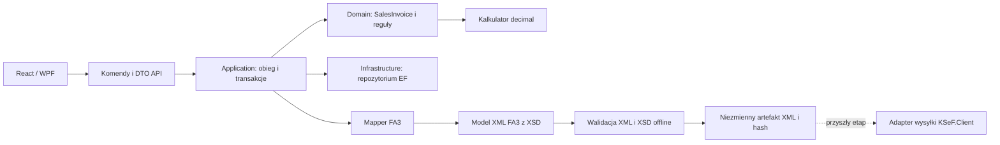

# Planowanie i wystawianie faktur sprzedażowych — analiza przedimplementacyjna

Data analizy: **25.11.2026**. Repozytorium: xKsef, HEAD `44dabd1bf60161fe50964e9c20f025f29f60b1d8`. Dokument jest propozycją do akceptacji, nie decyzją o zmianie architektury ani implementacją. Zakres: pełne FA(3); FA_RR(1) poza zakresem.

**Uzupełnienie zatwierdzone 27.11.2026:** etap 1 wdraża trzy metody VAT, rabat globalny i dokładniejsze wewnętrzne snapshoty kursów. Podstawa rabatu jest wybierana dla metody od pozycji, automatycznie netto dla sum netto i brutto dla sum brutto. Te ustalenia zastępują wcześniejsze propozycje tego raportu tam, gdzie są rozbieżne. Aktualny zakres, algorytmy i ograniczenia opisuje [dokumentacja etapu 1](SALES_INVOICE_STAGE1.md); pozostałe rozdziały poniżej zachowują charakter historycznej analizy przedimplementacyjnej.

## 1. Wynik i sposób korzystania z raportu

Rekomenduję osobny agregat `SalesInvoice`, dodany w istniejących warstwach Domain → Application → Infrastructure → API, z osobnymi kontraktami dla React i WPF. `StoredInvoice`, import, poświadczenia i ich ochrona pozostają odrębnymi mechanizmami. Model danych powinien łączyć relacyjny rdzeń z typowanymi, wersjonowanymi strukturami JSON dla rozbudowanych sekcji FA(3). Model serializacji XML należy oddzielić od encji EF i wygenerować z przypiętego XSD po sprawdzeniu generatora.

Najważniejsze kwestie wymagające uzgodnienia przed implementacją:

1. Niezależna numeracja tenantów musi używać rozłącznych serii dla tego samego NIP. Sam indeks `(TenantId, InvoiceNumber)` nie zapobiega duplikatom w KSeF.
2. Zwykłe sumowanie pozycji jest właściwe dla zwykłej sprzedaży, ale zaliczki, rozliczenia zaliczek, korekty i marża wymagają osobnych strategii. Pełne wartości zamówienia nie są kwotą zaliczki.
3. Sześć uzgodnionych statusów wystarczy do obiegu online, lecz pełna obsługa offline wymaga dodatkowej informacji o prawnym wystawieniu dokumentu przed przyjęciem w KSeF. Nie można uzależnić całego znaczenia „wystawiona” wyłącznie od numeru KSeF.
4. Nie wolno automatycznie zmieniać zatwierdzonego `P_1`, gdy proces spóźni się z wysyłką. Wysyłka w kolejnym dniu może wejść w reżim offline24.
5. Pełne FA(3) obejmuje strukturalny załącznik, wymagający uprawnienia i docelowo sesji wsadowej; pojedynczy mechanizm sesji interaktywnej nie pokryje zakresu.

Integralną częścią raportu jest [załącznik A: kompletna hierarchia, mapowanie i ograniczenia XSD](analysis/FA3_ELEMENT_MAPPING.md). Zawiera **411 wpisów**: wszystkie osiągalne elementy, atrybuty i treść simpleContent, **129 grup** SEQUENCE/CHOICE oraz katalog **78 nazwanych typów prostych**, również z zależności. Nie pomija sekcji rzadkich. Każda ścieżka ma miejsce w proponowanym modelu albo wyjaśniony sposób utrwalenia w artefakcie. Rozdziały 5–9 nadają temu katalogowi semantykę domenową i fizyczny sposób zapisu.

Oficjalne źródła pobrano do [katalogu źródeł](analysis/fa3-sources/README.md): cztery XSD, aktualną broszurę, podręczniki MF, przykłady oraz dokument reguł weryfikacji. Źródłowe XSD zachowano bez zmiany bajtów, namespace i schemaLocation. Nie uruchamiano aplikacji, nie wykonywano połączeń z API KSeF, migracji, operacji bazodanowych, instalacji pakietów, commita ani push.

## 2. Rzeczywisty stan rozwiązania

### 2.1. Warstwy i zależności

Źródłem ustaleń są pliki `.csproj`, `XKsef.slnx`, rejestracja DI i wskazane niżej implementacje. `docs/XKSEF_CONTEXT.md` został przeczytany przed analizą, ale zawiera starszy opis.

| Komponent | Stan odczytany z kodu | Znaczenie dla nowego modułu |
|---|---|---|
| `XKsef.Domain` | .NET 10, modele faktur, tenantów, kontrahentów i uwierzytelniania KSeF | Tu umieścić agregat i niezmienniki; bez EF, HTTP i XmlSerializer |
| `xKesf.Application` | Istnieje; referencje do Domain i Contracts; serwisy importu, kontrahentów, interfejsy repozytoriów i usług | Zachować rzeczywistą pisownię katalogu; większość namespace to `xKsef.Application`, występuje też `xKesf.Application.Contractors` |
| `xKsef.Contracts` | Wspólne kontrakty API, między innymi odczyt faktur i tenantów | Osobne DTO i komendy SalesInvoice; nie rozszerzać przypadkowo kontraktu importu |
| `xKsef.Infrastructure` | Application + Domain, SQL Server, EF Core 10.0.13, KSeF.Client 2.8.1, generowanie PDF | Repozytorium, konfiguracje EF, lokalny adapter FA(3), walidator XSD; kiedyś adapter wysyłki |
| `xKsef.Api` | Application + Contracts + Infrastructure; kontrolery, Identity, JWT, sesja przeglądarkowa i CSRF | Komendy obiegu i obliczeń; tenant z uwierzytelnionego kontekstu |
| `xKsef.Web` | Oddzielny projekt npm; React 19.3.1, TypeScript 5.9.3, Vite 8.3.8, AG Grid; strony faktur i kontrahentów | Istniejący klient API, obsługa zmiany kontekstu i formularze do ponownego użycia; brak edytora faktury sprzedażowej |
| `xKsef.Wpf` | .NET 10 Windows, MVVM, klienci HTTP i kontekst tenanta | Możliwy drugi klient tego samego API, bez obliczeń wiążących w ViewModel |
| `xKsef.CredentialService` | Osobna usługa i baza poświadczeń | Nie zmieniać szyfrowania ani przechowywania sekretów; przyszły proces serwerowy wymaga osobnej decyzji o tożsamości wykonawczej |
| `xKsef.Tests` | xUnit, .NET 10 Windows/WPF, TestHost, SQLite i InMemory; istnieją testy izolacji i importu | Nowe testy można dodawać w istniejącej strukturze; blokady SQL i rowversion wymagają prawdziwego SQL Server |

`xKsef.Web` nie jest wpisany jako projekt .NET w `.slnx`; to nie oznacza braku React. `AppDbContext` znajduje się w katalogu `Persistance`, natomiast namespace używa `Persistence`. Konwencje są mieszane: tabela importu to `invoices`, pozostałe np. `Tenants`, `ContractorsData`. Nowy moduł powinien przyjąć nazwy `SalesInvoices`, `SalesInvoiceLines` itd.; porządkowanie istniejących nazw nie należy do tego zadania.

Rejestracja w `xKsef.Infrastructure/DependencyInjection.cs` łączy interfejsy Application z implementacjami. PDF w DI to `NodeInvoicePdfGenerator`; obecność parserów i alternatywnych generatorów nie dowodzi, że wszystkie są aktywne. `AddKsefInfrastructure` może rejestrować warmup kryptografii podczas startu. Dlatego nawet „tylko uruchomienie API do sprawdzenia” mogłoby spowodować połączenie z KSeF i nie było wykonywane.

### 2.2. StoredInvoice i import

Źródła: `XKsef.Domain/Invoices/StoredInvoice.cs`, `xKesf.Application/Invoices/{InvoiceImportService,StoredInvoiceFactory,ValidatedInvoice}.cs`, `xKsef.Infrastructure/Ksef/Invoices/{InvoicePackageImportService,InvoicePackageValidator,InvoicePackageMetadataReader}.cs`, `xKsef.Infrastructure/Persistance/{InvoiceRepository,InvoiceImportTransaction}.cs`, konfiguracja `StoredInvoiceConfiguration`.

`StoredInvoice` ma PK `long Id`, `Guid TenantId`, numer KSeF, własny numer faktury, `DateOnly IssueDate`, kierunek, kwoty `decimal`, walutę, podstawowe dane stron, daty `DateTimeOffset` oraz pełny `byte[] XmlBytes`. Wartości netto/VAT/VAT PLN są nullable, brutto wymagane. XML jest kopiowany na wejściu i wyjściu właściwości, a EF korzysta z pola. Kwoty SQL to `decimal(18,2)`, numer faktury ma limit 100, nazwa sprzedawcy 250, nazwa nabywcy 512, waluta 3. Te limity służą obecnemu odczytowi; nie wolno bezrefleksyjnie powielać ich w nowym modelu obejmującym nazwę FA(3) do 512 i numer do 256 znaków.

Import odczytuje `_metadata.json`, sprawdza nazwy i ścieżki plików, obecność XML oraz SHA-256, tworzy `ValidatedInvoice`, parsuje metadane, buduje `StoredInvoice`, nadaje TenantId i zapisuje. Duplikat jest sprawdzany aplikacyjnie oraz zabezpieczony unikalnym indeksem `(TenantId, KsefNumber)`; błędy SQL 2601/2627 są tłumaczone na wyjątek domeny aplikacyjnej. `InvoiceImportTransaction` korzysta z transakcyjnego `sp_getapplock` o wspólnej nazwie `xKsef.InvoiceImport`. Nie należy wykorzystywać tej globalnej blokady jako licznika nowego modułu.

`ValidatedInvoice` oznacza wynik kontroli importowej, **nie pełną walidację FA(3) względem XSD ani poprawność podatkową**. Import zostaje bez zmian. Po docelowym wystawieniu można powiązać dokument z później pobranym `StoredInvoice` według `(TenantId, KsefNumber)`, przez nową relację po stronie SalesInvoice albo osobną tabelę powiązań. Nie wymaga to zmiany przepływu importu ani automatycznego tworzenia importowanego rekordu przez nowy moduł. Obie listy muszą wyjaśniać użytkownikowi, że może oglądać ten sam dokument z dwóch perspektyw.

### 2.3. Własna firma i kontrahenci

`Tenant`: `Guid Id`, `Name` do 200, `IsActive`, `TaxEntityId`. `TaxEntity`: `Guid Id`, `Nip` do 10, `Name` do 200. NIP jest unikalny **w TaxEntities**, lecz wiele tenantów może wskazywać ten sam TaxEntity. `TenantService.CreateAsync` ponownie używa podmiotu znalezionego po NIP. Tenant nie ma adresu, EORI, danych kontaktowych, rachunków ani rejestrów firmy.

Propozycja: osobny `TenantSalesProfile` powiązany 1:1 z Tenant, dostarczający wartości domyślne sprzedawcy, rachunków, adnotacji i stopki. NIP źródłowo z właściwego TaxEntity; profil nie może samowolnie pozwalać na zmianę tożsamości sprzedawcy. Nie dodawać tenantowych danych adresowych do wspólnego TaxEntity bez decyzji o współdzieleniu danych. Profil kopiuje się do `SalesInvoice.Seller`. Zmiana profilu lub TaxEntity nie aktualizuje wystawionych ani zatwierdzonych dokumentów.

Kartoteka: `Contractor(Guid Id, Guid TenantId, bool IsActive, DateTimeOffset CreatedAt)` → `ContractorsData` 1:1 → `Address` → `AddressesData` 1:1. `ContractorsData` zawiera pełną nazwę 500, skrót 100, NIP 20, REGON 14, KRS 10, VAT UE 32, inny numer 100 oraz flagę rejestracji VAT UE. Dane adresowe: kraj 2, ulica 200, budynek/lokal/kod do 20, miasto 200. Obecny `AddressType` obsługuje tylko siedzibę. Tabele podrzędne nie mają TenantId; repozytorium dochodzi do niego przez relacje i jawne JOIN/WHERE.

Nie jest to model pełnego podmiotu FA(3): brak rozdzielenia KodUE/NrVatUE, kraju innego identyfikatora, IDWew, GLN, EORI, adresu korespondencyjnego, ról JST/GV, udziałów i kontaktów. W modelu faktury wszystkie te dane muszą mieć niezależne pola, nawet jeśli kartoteka jeszcze ich nie obsługuje. Nie wymuszać ich rozbudowy w jednym etapie z fakturami: brakujące informacje można wpisać w Draft, bez automatycznego zapisu do kartoteki.

`ContractorIdentifierValidator` sprawdza m.in. sumę kontrolną NIP, ale zwraca oryginalną postać z dopuszczonymi separatorami. Adapter FA(3) musi osobno wyprowadzić 10 cyfr. VAT UE w kartotece ma słabiej określony format i większą długość niż `TNrVatUE` w XSD; rozdzielenie prefiksu i części numerowej oraz walidacja XSD są obowiązkowe. Kodu UE `EL` nie wolno zastępować automatycznie kodem kraju adresowego `GR`; Irlandia Północna ma `XI`.

Źródłowe `ContractorId` i wersja danych są informacją pochodzenia, nie danymi faktury „na żywo”. Odświeżenie w Draft to jawna komenda zastępująca wskazaną kopię danych, ponowne przeliczenie/walidacja i zapis audytu; żaden GET ani otwarcie ekranu nie odświeża danych samoczynnie. Odświeżenie nazwy/adresu sprzedawcy nie powinno po numeracji podmieniać jego NIP.

### 2.4. Autoryzacja i izolacja

`TenantAuthorizationFilter` wymaga uwierzytelnienia, identyfikatora użytkownika i poprawnego `X-Tenant-Id`, sprawdza `ITenantAccessService.HasAccessAsync` i umieszcza zaufany TenantId w `HttpContext.Items`. Dostęp wymaga wpisu UserTenants oraz aktywnego tenanta. `GetRolesAsync` istnieje, ale sam filtr tenantowy nie rozróżnia prawa odczytu, edycji i zatwierdzania.

WPF korzysta z JWT, React z sesji cookie po stronie serwera i CSRF. `BrowserAuthentication` wybiera schemat według obecności nagłówka Authorization; operacje przeglądarkowe podlegają `BrowserCsrfFilter`. React ma `RequestContext`, anulowanie starych żądań i ochronę przed wynikami z poprzedniego tenanta. To należy zachować także przy autosave, podglądzie i kalkulacji Draft.

`AppDbContext` nie definiuje globalnych filtrów tenantowych ani RLS; izolacja odczytów opiera się na jawnych warunkach repozytoriów/usług. Nie wolno zakładać, że EF odfiltruje cudze faktury. Proponowane dodatkowe zabezpieczenia dotyczą nowego modułu, nie przebudowy działającej autoryzacji.

## 3. Źródła i tożsamość FA(3)

Oficjalny wzór: **13775**, publikacja **25.06.2025**, namespace `http://crd.gov.pl/wzor/2025/06/25/13775/`. Nagłówek: tekst `FA`, `kodSystemowy="FA (3)"`, `wersjaSchemy="1-0E"`, `WariantFormularza=3`. Struktura obowiązuje od 01.02.2026; aktualna strona MF nadal wskazuje ten wzór. [Strona MF](https://ksef.podatki.gov.pl/informacje-ogolne-ksef-20/struktura-logiczna-fa-3/), [schemat CRD](https://crd.gov.pl/wzor/2025/06/25/13775/schemat.xsd).

Domknięty graf zależności:

```text
schemat.xsd (FA3, 13775)
└─ import etd: StrukturyDanych_v10-0E.xsd
   └─ include ElementarneTypyDanych_v10-0E.xsd
      └─ include KodyKrajow_v10-0E.xsd
```

Wszystkie cztery pliki pobrano z CRD. Oryginalne odwołania są HTTP; pobieranie wykonano po HTTPS, zachowując namespace HTTP. Kompilacja lokalna w `XmlSchemaSet` przeszła. Zależności zarejestrowano jawnie w pamięci, usuwając tylko z obiektów odwołania do pobierania sieciowego; pliki źródłowe nie zostały przepisane. Produkcyjny walidator powinien używać zamkniętego katalogu URI → lokalny plik, nigdy dowolnego pobierania importów z sieci.

Podstawową dokumentacją semantyczną jest **broszura FA(3), Warszawa, sierpień 2026, 173 strony**, wskazana przez aktualną stronę pobrań MF. Wcześniejsza broszura z marca 2026 nie jest podstawą końcowego raportu. Dodatkowo uwzględniono podręcznik cz. II z 06.08.2026 i cz. III z 06.11.2026 oraz oficjalne reguły weryfikacji XML z repozytorium CIRFMF. [Aktualne pliki MF](https://ksef.podatki.gov.pl/pliki-do-pobrania-ksef-20/).

Schemat i broszura pełnią różne role: `minOccurs=0` nie znaczy „nigdy nieobowiązkowe podatkowo”. XSD dopuszcza technicznie dokument bez wierszy oraz bez wielu wartości, które dla konkretnej transakcji są ustawowo niezbędne. Poprawność XML, poprawność biznesowa oraz przyjęcie przez KSeF są trzema osobnymi wynikami.

## 4. Typy, precyzja i kompletność modelu

### 4.1. Typy liczbowe i tekstowe

Poniższe wartości wynikają z pobranego XSD; pełne facety, regexy i zamknięte słowniki znajdują się w załączniku A.

| Rodzina | Ograniczenie FA(3) | Proponowane CLR / SQL |
|---|---|---|
| `TKwotowy` | totalDigits 18, fractionDigits 2, do 16 cyfr części całkowitej, wartości ujemne dopuszczone | `decimal` / `decimal(18,2)` |
| `TKwotowy2` | totalDigits 22, fractionDigits 8, do 14 cyfr części całkowitej | `decimal` / `decimal(22,8)`; ceny i P_10 |
| `TIlosci` | totalDigits 22, fractionDigits 6, do 16 cyfr całkowitych | `decimal` / `decimal(22,6)`; ilości i kursy zgodnie z konkretną ścieżką |
| `TProcentowy` | totalDigits 9, fractionDigits 6, 0..100 | `decimal` / `decimal(9,6)`; też udział i stawka OSS |
| `TNaturalny` | całkowity, >0, brak górnego limitu w definicji | biznesowo numer pozycji `int` z jawnym zakresem; pozostałe nieograniczone liczby zachować jako `BigInteger`/tekst dziesiętny w adapterze, nie zawężać bez decyzji |
| `TZnakowy` / `TZnakowy2` | 1..256 / 0..256; xs:token | `string` / `nvarchar(256)`; pusty tekst i brak elementu są różne |
| warianty 20 / 50 / 512 | 1..20 / 1..50 / 1..512 | odpowiednie `nvarchar(n)` |
| NIP / VAT UE / IDWew | regex z XSD, VAT UE 1..12 bez KodUE, IDWew NIP + 5 cyfr | `string`; identyfikatory nie są liczbami do obliczeń |
| Rachunek / SWIFT / GLN / telefon | rachunek 10..34; BIC 8 lub 11; GLN 1..13; telefon do 16 | odrębne value objects; XSD nie zastępuje sumy kontrolnej IBAN/GLN |
| Waluta i kraj | zamknięte wyliczenia z tej wersji XSD | `string` / kod; waluta SQL 3, kraj 2; nie dowolne bieżące ISO |

Nie wszystkie teksty mają długość 256: Nazwa, AdresL1/L2, P_7/P_7Z i LinkDoPlatnosci mają do 512; IDNabywcy ma do 32, IPKSeF 13. Limity adresów kartoteki nie są limitami dwóch swobodnych linii adresu FA(3). REGON/KRS z kartoteki nie są automatycznie identyfikatorem podatkowym w DaneIdentyfikacyjne.

`DateOnly` → `date`; znaczniki audytowe → `DateTimeOffset` / `datetimeoffset(7)`, UTC. `TData` ma zakres 01.07.2016–01.01.2050, `TDataT` od 01.01.2006, `TDataU` od 01.01.1990. Data wytworzenia w nagłówku ma własne zawężenie od 01.09.2025. Każde pole stosuje własny typ z załącznika. Daty transportu wymagają zachowania semantyki czasu i strefy; wejście bez offsetu musi mieć jawnie ustaloną strefę, nie strefę systemu operacyjnego. Nie przypisywać fikcyjnego UTC do lokalnej daty.

Własne wartości Draft mogą być niekompletne; wymagania finalnego XSD sprawdza się przy zatwierdzeniu i tworzeniu artefaktu. Nie zapisywać `0`, `Guid.Empty`, pustego NIP czy daty minimalnej jako zastępstwa „jeszcze nieuzupełnione”.

### 4.2. Kompletna struktura najwyższego poziomu

| Sekcja | Liczebność | Zawartość i miejsce w modelu |
|---|---|---|
| Naglowek | 1 | Identyfikacja schematu, data wytworzenia, SystemInfo → nagłówek artefaktu |
| Podmiot1 | 1 | Sprzedawca, identyfikacja, adres, korespondencja, kontakty, status → Seller snapshot |
| Podmiot2 | 1 | Nabywca, wariant identyfikatora, adresy, kontakty, JST/GV → Buyer snapshot |
| Podmiot3 | 0..100 | Pozostali uczestnicy, role i udział → ThirdParties |
| PodmiotUpowazniony | 0..1 | Organ/komornik/przedstawiciel → AuthorizedParty |
| Fa | 1 | Dane dokumentu, sumy, adnotacje, korekty, zaliczki, wiersze, płatności i transakcja |
| Stopka | 0..1 | Informacje 0..3 i rejestry 0..100 → Footer |
| Zalacznik | 0..1 | Bloki danych i tabele → Attachment |

Pełne drzewo wszystkich poziomów jest w załączniku A. Nie należy interpretować tabeli powyżej jako całej hierarchii.

## 5. Semantyka sekcji, warianty i wymagania warunkowe

### 5.1. Podmioty i adresy

Sprzedawca i podmiot upoważniony mają wymagane NIP, nazwę i adres. Nabywca ma dokładnie jeden wariant identyfikacji: NIP **albo** KodUE+NrVatUE **albo** opcjonalny KodKraju+NrID **albo** BrakID=1. Podmiot3 dodatkowo dopuszcza IDWew. Nazwa i adres nabywcy mogą być opcjonalne w XSD, lecz zwykle są wymagane przepisami; wyjątki, np. UPR, sprawdza profil walidacji. Nie wybierać BrakID tylko dlatego, że użytkownik nie uzupełnił kartoteki.

Adres ma KodKraju i AdresL1, opcjonalne AdresL2 i GLN. Adres korespondencyjny jest odrębny. Kontakty występują do 3 razy na podmiot; podmiot upoważniony używa EmailPU/TelefonPU. Nie przenosić automatycznie tych nazw do innych typów kontaktu.

Podmiot2/JST i GV są zawsze obecne, w wartościach zgodnych z XSD. Oznaczenie transakcji dla JST lub grupy VAT wymaga właściwych jednostek/członków w Podmiot3 i uprawnień do obsługi danej relacji. Sam Tenant nie jest jednostką wewnętrzną KSeF. IDNabywcy wiąże wskazania podmiotów zgodnie z ich rolą, nie jest zamiennikiem TenantId.

Role Podmiot3: 1 faktor, 2 odbiorca, 3 podmiot pierwotny, 4 dodatkowy nabywca, 5 wystawca w imieniu sprzedawcy, 6 płatnik, 7 JST wystawca, 8 JST odbiorca, 9 członek GV wystawca, 10 członek GV odbiorca, 11 pracownik. Alternatywa: RolaInna=1 z obowiązkowym OpisRoli. Udzial jest procentem; powiązania i sumy udziałów weryfikować dla grupy nabywców, bez narzucania sumy 100 dowolnym rolom. RolaPU: 1 organ egzekucyjny, 2 komornik, 3 przedstawiciel podatkowy. StatusInfoPodatnika jest osobnym słownikiem, nie statusem SalesInvoice.

Samofakturowanie nie odwraca automatycznie Seller/Buyer. Podmiot1 nadal wskazuje sprzedawcę, a wykonujący operację może reprezentować nabywcę. Wymaga to walidacji uprawnień i odrębnego scenariusza; nie wolno wymusić reguły „NIP sprzedawcy zawsze równy bieżącemu kontekstowi uwierzytelnienia KSeF” bez uwzględnienia samofakturowania i pełnomocnictw.

### 5.2. Wszystkie rodzaje faktur

`TRodzajFaktury` ma siedem wartości. Rodzaj dokumentu, procedura VAT i status obiegu są niezależnymi osiami.

| Rodzaj | Dane i kalkulacja | Warunki istotne dla modelu |
|---|---|---|
| VAT | Zwykła sprzedaż, w tym szczególne procedury | Wiersze i pola wymagane zależą od konkretnej transakcji; nie wszystkie faktury VAT mają jawne netto i VAT |
| KOR | Korekta sprzedaży | Referencje faktur pierwotnych, wartości różnicowe, ewentualny stan przed/po, oryginalne dane stron |
| ZAL | Zaliczka / faktura z art. 106f ust. 4 | Kwota zaliczki, jej VAT i dane zamówienia; kwota zamówienia nie zastępuje zaliczki |
| ROZ | Rozliczenie z art. 106f ust. 3 | Pełne pozycje transakcji, odjęcie rozliczanych zaliczek w podsumowaniach, referencje |
| UPR | Uproszczona z art. 106e ust. 5 pkt 3 | Limit 450 PLN lub 100 EUR, wymagany identyfikator i informacje pozwalające ustalić VAT; pozostałe ograniczenia ustawowe, nie sam test kwoty |
| KOR_ZAL | Korekta zaliczki | Zmiana zaliczki i VAT; P_15ZK jako kwota przed korektą, ewentualny KursWalutyZK |
| KOR_ROZ | Korekta rozliczenia | Odrębna interpretacja reszty do zapłaty przed/po korekcie i powiązań zaliczek |

Marża, zwolnienie, WDT, eksport, odwrotne obciążenie, OSS, metoda kasowa, samofakturowanie, MPP oraz nowe środki transportu nie są dodatkowymi wartościami `RodzajFaktury`. Muszą być modelowane w pozycjach, kwalifikacji podatkowej i adnotacjach.

### 5.3. Wszystkie stawki i oznaczenia VAT

| P_12 | Koszyk podsumowania | Zasada |
|---|---|---|
| 23, 22 | P_13_1 / P_14_1 | Stawka podstawowa, także historyczna |
| 8, 7 | P_13_2 / P_14_2 | Pierwsza obniżona |
| 5 | P_13_3 / P_14_3 | Druga obniżona |
| 4, 3 | P_13_4 / P_14_4 | Ryczałt dla taksówek, uwzględnić datę i przepisy historyczne |
| 0 KR | P_13_6_1 | Krajowa stawka 0; nie łączyć z WDT i eksportem |
| 0 WDT | P_13_6_2 | WDT; odrębne warunki transakcji |
| 0 EX | P_13_6_3 | Eksport |
| zw | P_13_7 | Zwolnienie, adnotacja i podstawa właściwa dla zwolnienia |
| np I | P_13_8 | Poza terytorium kraju z wyłączeniami wskazanymi w XSD |
| np II | P_13_9 | Usługi z art. 100 ust. 1 pkt 4 |
| oo | P_13_10 | Krajowe odwrotne obciążenie według właściwej podstawy |
| P_12_XII (0..100, do 6 miejsc) | P_13_5 / opcjonalne P_14_5 | VAT innego państwa w procedurze szczególnej; nie zamieniać na krajową stawkę P_12 |
| Procedura marży | P_13_11 | Wartość sprzedaży w procedurze marży; nie „netto” i nie publicznie ujawniony VAT od marży |

Nie tworzyć jednej liczbowej `VatRate=0` dla zw/np/oo/stawek 0. Proponowany `TaxTreatment` rozróżnia kategorię, kod FA, stawkę procentową, jurysdykcję i koszyk podsumowania. Same `23` i `22` mogą trafiać do jednego pola XML, ale w modelu kalkulacyjnym zachowują stawkę oryginalną. Nie narzucać obu naraz P_12 i P_12_XII bez warunków właściwej procedury; XSD nie wyraża wszystkich wykluczeń podatkowych.

`P_14_1W`…`P_14_4W` to VAT w PLN przy odpowiednich rozliczeniach walutowych. Nie ma `P_14_5W` w tym schemacie. Nie sumować `P_14_xW` do VAT w walucie dokumentu. Stawki historyczne są potrzebne m.in. przy korektach; dopuszczenie w enum nie upoważnia do stosowania stawki w nowej sprzedaży bez podstawy.

Oznaczenia dodatkowe: GTU_01…GTU_13; procedury wiersza `WSTO_EE`, `IED`, `TT_D`, `I_42`, `I_63`, `B_SPV`, `B_SPV_DOSTAWA`, `B_MPV_PROWIZJA`. Procedura zamówienia nie zawiera I_42/I_63. `P_12_Zal_15` i odpowiednik zamówienia są odrębnymi znacznikami towarów/usług z załącznika 15, a nie stawką. `KwotaAkcyzy`, `FP`, `TP`, `ZwrotAkcyzy` mają własną semantykę; nie zastępują GTU ani MPP.

### 5.4. Nagłówek Fa, adnotacje, terminy i korekty

| Grupa reguł | Wymagania / wykluczenia | Proponowana walidacja |
|---|---|---|
| P_1, P_2, KodWaluty, P_15, RodzajFaktury | Wymagane w finalnym XML | Draft może nie mieć numeru; finalny numer dopiero przy rozpoczęciu wystawiania |
| WZ | 0..1000 | Uporządkowane numery dokumentów, nie pozycje faktury |
| P_6 / OkresFa | CHOICE, najwyżej jedna gałąź; okres zawiera od i do | Zgodność dat, koniec ≥ początek; różna semantyka dat dostawy i zaliczki |
| P_13/P_14 | Grupy opcjonalne, ale pola parowane zgodnie z XSD; P_14_5 fakultatywne w grupie OSS | Wymagalność po kwalifikacji transakcji, brak koszyka ≠ zero we wszystkich koszykach |
| P_16/P_17/P_18/P_18A/P_23 | Wymagane znaczniki o wartościach ze schematu | Metoda kasowa, samofakturowanie, odwrotne obciążenie, MPP, procedura trójstronna; nie serializować bool jako true/false |
| Zwolnienie | P_19=1 i dokładnie jedna podstawa P_19A/B/C, albo P_19N=1 | Brak sprzecznego znacznika i podstawy; sprawdzić ustawowy wyjątek dla wskazania podstawy |
| NoweSrodkiTransportu | P_22=1, P_42_5 i 1..10000 środków albo P_22N=1 | Numer wiersza, data dopuszczenia, dane identyfikacyjne i właściwa gałąź pojazdu |
| NowySrodekTransportu | Gałąź lądowa P_22B, wodna P_22C albo lotnicza P_22D; warianty numerów lądowych wg CHOICE | Zachować markę, model, kolor, numery/rejestrację/rok i oznaczenie typu; nie sprowadzać do jednego opisu |
| PMarzy | P_PMarzy=1 i dokładnie jeden wariant 2 / 3_1 / 3_2 / 3_3 albo P_PMarzyN=1 | Turystyka / używane / sztuka / kolekcjonerskie i antyki; kontrola zakazu ujawniania określonych pól |
| DaneFaKorygowanej | 1..50000, jeśli wybrano grupę korekty | Data i numer pierwotny; albo NrKSeF=1+NrKSeFFaKorygowanej, albo NrKSeFN=1 |
| PrzyczynaKorekty / TypKorekty | XSD dopuszcza brak; TypKorekty 1/2/3 dotyczy skutku w ewidencji | Nie utożsamiać typu skutku podatkowego z metodą prezentacji różnic |
| Podmiot1K / Podmiot2K | Oryginalny sprzedawca 0..1, oryginalni nabywcy 0..101 | Zachować stare dane potrzebne do korekty; nie zastępować aktualnym snapshotem |
| NrFaKorygowany / OkresFaKorygowanej | Pola niezależne od referencji | Korekta numeru i okres dla zbiorczych korekt; numer historyczny pozostaje w referencji |
| P_15ZK / KursWalutyZK | Opcjonalna grupa, wymagana kwota jeśli grupa obecna | Stan przed korektą dla ZAL/ROZ; sprawdzać rodzaj faktury |
| ZaliczkaCzesciowa | 0..31: data, kwota i opcjonalny kurs | Wiele otrzymanych zaliczek; także właściwy przypadek dostawy w tym samym miesiącu; nie mieszać z płatnościami po sprzedaży |
| FakturaZaliczkowa | 0..100; numer zewnętrzny z NrKSeFZN albo numer KSeF | Referencje zaliczek do rozliczenia/łańcucha; bez fikcyjnego lokalnego FK do nieistniejącego dokumentu |
| DodatkowyOpis | 0..10000; klucz i wartość, opcjonalny numer wiersza | Służy do dodatkowych danych, nie zastępuje obligatoryjnych pól FA(3) |

Grupy CHOICE z załącznika A są kompletnym rejestrem wykluczeń technicznych. Dodatkowo walidacja domenowa musi sprawdzać zgodność procedur, dokumentowanych zdarzeń i uprawnień. Rozróżnienie „wymagany / warunkowo wymagany / dobrowolny” wynika łącznie z XSD, rodzaju dokumentu i rzeczywistej sytuacji gospodarczej. Nie da się wyznaczyć go wyłącznie przez generator klas.

### 5.5. Pozycje, zamówienie, płatności i rozliczenie

`FaWiersz` ma 0..10000 elementów; finalna zwykła sprzedaż powinna zawierać wymagane dane przedmiotu, choć XSD wymaga w wierszu zasadniczo numeru. Wiersz przechowuje UU_ID, własną datę P_6A, opis, indeks, GTIN, PKWiU, CN, PKOB, jednostkę, ilość, ceny netto/brutto, rabat, wartości netto/brutto/VAT, stawkę, OSS, znacznik załącznika 15, akcyzę, GTU, procedurę, kurs i StanPrzed. `NrWierszaFa` nie jest PK bazy ani UUID. Zachować kolejność i unikalność numerów w obrębie faktury; UU_ID zachować jako opcjonalny identyfikator zewnętrzny.

`Zamowienie` obejmuje wymaganą `WartoscZamowienia` brutto i 1..10000 `ZamowienieWiersz` z analogicznymi danymi przedmiotu, ilości, ceny netto, netto/VAT, podatku, klasyfikacji i stanu przed. To inna kolekcja niż FaWiersz: faktura zaliczkowa dokumentuje płatność za zamówienie, a nie pełną sprzedaż w wysokości tego zamówienia. Model zachowuje obie struktury i alokacje zaliczki między stawkami.

`Rozliczenie`: obciążenia 0..100 (kwota+powód), odliczenia 0..100 (kwota+powód), ich sumy oraz alternatywa DoZaplaty / DoRozliczenia. Te wartości nie służą do ukrywania rabatu zmniejszającego podstawę VAT. `P_15` jest kwotą należności wynikającą z dokumentowanej sprzedaży/zaliczki/korekty; saldo do zapłaty po dodatkowych rozliczeniach to inne pojęcie.

`Platnosc` ma opcjonalne, wzajemnie wykluczające się gałęzie: jednorazowo Zaplacono=1 z datą albo ZnacznikZaplatyCzesciowej i 1..100 wpłat. Znacznik częściowy 1 oznacza częściową spłatę, 2 całkowitą spłatę kilkoma wpłatami. Każda wpłata może mieć formę. Niezależnie występują terminy 0..100: data i/lub opis (ilość, jednostka, zdarzenie początkowe); nie zakładać jednej daty płatności na dokument.

Formy płatności: 1 gotówka, 2 karta, 3 bon, 4 czek, 5 kredyt, 6 przelew, 7 mobilna; alternatywa PlatnoscInna=1 z OpisPlatnosci. Rachunki sprzedawcy 0..100, faktora 0..20, każdy z NrRB oraz opcjonalnym SWIFT, typem własnego rachunku banku, nazwą i opisem. Dodatkowo Skonto (warunki i wysokość w postaci opisowej), LinkDoPlatnosci i IPKSeF. Żaden nowy link płatniczy nie jest automatycznym potwierdzeniem zapłaty.

Dane płatności stanowią treść wystawionego dokumentu. Późniejsze rozrachunki wymagają osobnego rejestru zdarzeń płatniczych albo przyszłego modułu należności; nie edytować utrwalonej faktury Issued po każdej wpłacie.

### 5.6. Warunki transakcji i transport

`WarunkiTransakcji`: umowy 0..100 i zamówienia referencyjne 0..100 (data/numer), partie towaru 0..1000, warunki dostawy, opcjonalna para KursUmowny+WalutaUmowna, transporty 0..20 i PodmiotPosredniczacy. Kurs umowny nie jest automatycznie kursem podatkowym.

Każdy transport wybiera RodzajTransportu z wartości 1 morski, 2 kolejowy, 3 drogowy, 4 lotniczy, 5 pocztowy, 7 instalacje przesyłowe, 8 śródlądowy albo TransportInny=1 z opisem. Ładunek wybiera wartość słownika 1..20 albo LadunekInny=1 z opisem. Nazwy wszystkich wartości i ich znaczenie są w adnotacjach `TLadunek` oficjalnego XSD; numery są kodami, nie ilością ładunku.

Przewoźnik jest opcjonalny, lecz jeśli wystąpi, zawiera identyfikację właściwą dla podmiotu oraz wymagany AdresPrzewoznika. Pozostałe dane: zlecenie, jednostka opakowania, początek/koniec transportu, WysylkaZ, do 20 WysylkaPrzez, WysylkaDo. Dla dat sprawdzać kolejność, a trasy nie sprowadzać do dwóch punktów. Model `TransactionTerms.Transport[]` przechowuje pełny snapshot danych, niezależnie od kartoteki.

### 5.7. Stopka i załącznik

Stopka ma teksty oraz rejestry: PelnaNazwa, KRS, REGON, BDO. Nie umieszczać tych numerów w NIP. Opcjonalny pusty kontener zwykle pominąć, zamiast produkować sekcję bez wartości.

Załącznik FA(3) **nie jest plikiem PDF, skanem ani dowolnym binarnym załącznikiem**. Ma 1..1000 bloków: nagłówek, 1..1000 par metadanych, opcjonalny tekst 1..10 akapitów oraz do 1000 tabel na blok. Tabela: do 1000 par metadanych, opis, nagłówek 1..20 kolumn, 1..1000 wierszy po 1..20 komórek i opcjonalna suma 1..20 komórek. Kolumna ma wymagany atrybut Typ: `date`, `datetime`, `dec`, `int`, `time`, `txt`. Komórki pozostają tekstem według schematu, lecz ich format trzeba sprawdzić semantycznie względem typu kolumny. Wiersze i suma powinny być zgodne z liczbą i kolejnością kolumn; samo XSD nie wiąże tych liczebności.

Teoretycznych maksimów wszystkich kolekcji nie wolno przemnażać i uznawać za dopuszczalny rozmiar pliku. Obowiązuje również limit bajtów i ograniczenia przetwarzania. Załącznik ma zawierać dane właściwe dla faktury, nie dowolną korespondencję. Wymaga uprzedniej realizacji zgłoszenia w e-US i odpowiedniego statusu możliwości wystawiania; samo UPO zgłoszenia nie wystarcza. Docelowo wysyłka w sesji wsadowej, z wyjątkiem szczególnej korekty technicznej offline. [Podręcznik MF cz. III](https://ksef.podatki.gov.pl/media/pr2dfos2/podrecznik-ksef-20-cz-iii-dodatkowe-funkcjonalnosci-ksef-06112026.pdf), [reguły weryfikacji MF](https://github.com/CIRFMF/ksef-api/blob/main/faktury/weryfikacja-faktury.md).

## 6. Proponowany podział odpowiedzialności



| Odpowiedzialność | Proponowany komponent i lokalizacja | Granice |
|---|---|---|
| Agregat i niezmienniki | Domain/SalesInvoices: SalesInvoice, Line, PartySnapshot, wartości pieniężne i podatkowe | Brak atrybutów EF/XML, HTTP i poświadczeń |
| Przypadki użycia | Application/SalesInvoices: Create/Update/Calculate/Approve/Revoke/Cancel | Kontrola tenantów, wersji, uprawnień, transakcji i statusów |
| Kalkulacje | Domain lub istniejąca Application, czysty `SalesInvoiceCalculator` z profilami rodzajów | Wejścia decimal, deterministyczne wyniki i wersja algorytmu; bez SQL i sieci |
| Walidacja biznesowa | `SalesInvoiceBusinessValidator`, profile rodzajów i procedur | Błędy ze ścieżką pola i kodem, kompletność Draft/Approve/Issue rozdzielona |
| Model XML | Infrastructure/SalesInvoices/Fa3/Generated, osobny namespace wersji | Odpowiada dokładnie XML, nie jest agregatem ani modelem edycji |
| Mapowanie | `SalesInvoiceFa3Mapper` | Jawna obsługa każdej ścieżki z załącznika; bez ukrytego liczenia kwot |
| Serializacja i XSD | `Fa3XmlSerializer`, `Fa3SchemaValidator` | Kolejność XML, namespace, UTF-8 bez BOM, walidacja na lokalnych schematach |
| Trwałość | `ISalesInvoiceRepository` i implementacja EF | Jawny TenantId we wszystkich operacjach; indeksy, transakcje i concurrency |
| Techniczny proces wysyłki | W przyszłości `SalesInvoiceIssuingCoordinator` i worker w istniejącym hostingu | Osobny adapter do KSeF.Client, bez przebudowy CredentialService w tym etapie |

Nie proponuję nowego mikroserwisu, brokera ani zmiany kierunku zależności projektów. Rozdzielenie logiczne nie wymaga osobnego `.csproj`. Uprawnienia wystawiania, polityka poświadczenia procesu oraz pełny offline są decyzjami przed etapem wysyłki.

### 6.1. Generowanie modeli C# i ponowne użycie bibliotek

Automatyczne generowanie jest zasadne dla modelu transportowego. Kandydatem jest `XmlSchemaClassGenerator` generujący klasy zgodne z XmlSerializer; alternatywą `xsd.exe` z ekosystemu .NET Framework, który wymaga więcej adapterów dla współczesnych typów. W tym zadaniu **nie instalowano ani nie uruchamiano generatora klas aplikacyjnych**. [Dokumentacja generatora](https://github.com/mganss/XmlSchemaClassGenerator/blob/master/README.md).

Przed wyborem wykonać mały eksperyment poza encjami: wszystkie gałęzie CHOICE, Specified/ShouldSerialize dla opcjonalnych liczb, zero vs brak, stałe i atrybuty, xs:token, enum ze spacjami `0 KR`/`np I`, daty, nierozróżnialne nazwy w różnych sekcjach, elementy powtarzalne i sumy ujemne. Sprawdzić, czy generator nie zamienia finansów na double i czy nie ogranicza xs:integer do zbyt małego typu. `DateOnly` w domenie może wymagać adaptera do DateTime/string modelu XML. C# nullable i DataAnnotations nie egzekwują całego XSD.

Wygenerowany kod przypiąć do hashów czterech XSD i konkretnej wersji narzędzia/argumentów. Zmiany w partial/adapters, bez ręcznego poprawiania pliku generowanego. Regeneracja ma być powtarzalna i sprawdzana diffem. Dowolna zmiana XSD to nowa wersja adaptera, nie cicha reinterpretacja istniejących faktur.

KSeF.Client **2.8.1** jest już zainstalowany. Sprawdzono lokalne dokumentacje XML pakietów Client i Core: są interfejsy `IOnlineSessionClient` (otwarcie/wysłanie/zamknięcie), statusy sesji/faktur, UPO, eksport/import, kryptografia i sprawdzenie uprawnienia załączników. To API komunikacyjne, nie gotowy agregat edycji ani kalkulator VAT. W odczytanych publicznych opisach modeli nie ma kompletnego modelu zawartości Faktura FA(3) do wykorzystania jako encja. Brak wpisu w dokumentacji nie jest formalnym dowodem braku każdego typu w DLL; przed implementacją potwierdzić publiczne typy konkretnego pakietu eksperymentem generatora/kompilacji. Oficjalne repozytorium rozdziela modele API i logikę klienta. [CIRFMF/ksef-client-csharp](https://github.com/CIRFMF/ksef-client-csharp).

Repozytorium zawiera również TypeScript `tools/ksef-pdf-generator/src/lib-public/types/fa3.types.ts` i generatory FA3. Przydatne do wizualizacji i przykładów, nie jako wiążący model domeny C# ani źródło ograniczeń podatkowych. Nie przenosić finansowych obliczeń backendu do generatora PDF.

## 7. Propozycja modelu trwałego

### 7.1. Warianty zapisu w EF Core 10 / SQL Server

| Wariant | Zalety | Ograniczenia w xKsef | Rekomendowane zastosowanie |
|---|---|---|---|
| Tabele relacyjne / zwykłe encje podrzędne | Indeksy, FK, tenantowe klucze, raporty, aktualizacje pojedynczych pozycji | Wiele tabel przy odwzorowaniu każdego węzła XML; koszt JOIN i migracji | Faktura, wiersze, podsumowania, strony, referencje, próby, numeracja i audyt |
| Complex Types | Semantyka value object, brak własnej tożsamości; kolumny rodzica lub JSON | Brak własnego DbSet, nawigacji encji i osobnych tabel; nullable wymaga wymaganej właściwości | Małe wartości kwotowe/adresowe i typowany fragment JSON |
| Owned Entities | Własność agregatu, OwnsOne/OwnsMany, osobna tabela lub JSON | Tożsamość/śledzenie EF, koszty kluczy i większa złożoność; nie są współdzielonym obiektem kartoteki | Alternatywa dla podkolekcji o wyłącznej własności, po eksperymencie mapowania |
| Typowany JSON w `nvarchar(max)` | Zachowanie rozbudowanych wariantów i kolejności bez setek tabel | Trudniejsze FK/checki, indeksowanie, migracja wersji kontraktu i duże aktualizacje; wymagane ISJSON | Adnotacje, płatność, transport, stopka, zamówienie i załącznik |
| Natywny SQL `json` | Integracja EF10 z nowym typem SQL | Wymaga właściwej wersji SQL Server 2025/kompatybilności; wersji serwera nie sprawdzano, bo nie łączono z bazą | Opcjonalna przyszła optymalizacja, nie założenie projektu |
| Sam XML / dowolny słownik | Brak utraty serializowanej treści | Brak dobrego obiegu, typów, raportów i reguł edycji; ryzyko „drugiego modelu w stringu” | Wyłącznie niezmienny artefakt wygenerowanego dokumentu |

EF10 obsługuje Complex Types mapowane do JSON i opcjonalne complex properties. Nie należy opierać projektu na funkcjach opisanych dopiero dla nowszej wersji EF. W szczególności wsparcie konkretnego kształtu kolekcji i zagnieżdżeń należy potwierdzić na **zainstalowanym 10.0.13**, nie na samym przykładzie z bieżącej dokumentacji. Jeśli kształt nie jest obsługiwany natywnie, zwykła encja z typowanym kontraktem serializowanym do nvarchar(max) pozostaje wykonalnym wariantem. Potrzebny jest poprawny ValueComparer/snapshot dla zmiennych struktur albo konsekwentnie niezmienne obiekty zastępowane w całości. [EF10](https://learn.microsoft.com/en-us/ef/core/what-is-new/ef-core-10.0/whatsnew), [Complex Types](https://learn.microsoft.com/en-us/ef/core/modeling/complex-types), [Owned Entities](https://learn.microsoft.com/en-us/ef/core/modeling/owned-entities).

Rekomendacja jest hybrydowa, bez zależności od SQL Server 2025. Nie wykonywać globalnej zmiany compatibility level ani zmiany istniejących kolumn. Model fizyczny oraz wybór kompleksów vs jawnej serializacji JSON wymagają akceptacji i próby mapowania przed migracją.

### 7.2. Rdzeń i pola operacyjne

Poniżej propozycja typów, nie kod encji. `?` oznacza nullable. Każdy nowy rekord przypisany do faktury ma `TenantId: Guid` oraz klucz właściciela; child JSON dziedziczy izolację wiersza właściciela. PK zwykłych nowych encji proponuję Guid, zgodnie z kartotekami; istniejący StoredInvoice.Id pozostaje long. Duże tabele mogą wymagać sekwencyjnego tworzenia GUID lub osobnego klucza klastrowanego po pomiarach.

| Encja / tabela | Pola główne i typy | Relacje |
|---|---|---|
| `SalesInvoice` / SalesInvoices | Id Guid, TenantId Guid, Status enum/int, Kind enum/kod, PlannedIssueDate DateOnly?, IssueDate DateOnly?, IssuePlace string(256)?, Currency string(3)?, InvoiceNumber string(256)?, NumberSeriesId Guid?, NumberPeriod string(16)?, SequenceNumber long?, Revision int, SchemaVersion string(32), CalculationVersion string(32), CreatedAt/UpdatedAt DateTimeOffset, CreatedBy/UpdatedBy string(450), ApprovedAt DateTimeOffset?, ApprovedBy string(450)?, ApprovedRevision int?, ProcessingStartedAt DateTimeOffset?, KsefNumber string(100)?, KsefAcceptedAt DateTimeOffset?, RowVersion byte[8] | Tenant N:1, pozostałe sekcje należą do agregatu |
| `SalesInvoicePartySnapshot` / SalesInvoiceParties | Id Guid, TenantId, SalesInvoiceId Guid, PartyKind enum (Seller/Buyer/Third/Authorized/OriginalSeller/OriginalBuyer), Ordinal int, SourceContractorId Guid?, SourceProfileVersion int?, SnapshotAt DateTimeOffset, IdentifierKind enum, Nip string(10)?, Name string(512)?, kod UE i numer, kod kraju i NrID, IDWew; DetailsJson | 1 wymagany Seller i Buyer przy zatwierdzeniu; pozostałe wg limitów; reszta pól party zgodnie z A |
| `SalesInvoiceLine` / SalesInvoiceLines | Id Guid, TenantId, SalesInvoiceId, LineNumber int, CalculationMode enum Net/Gross, Quantity decimal(22,6)?, Unit string(256)?, Description string(512)?, InputUnitPrice decimal(22,8)?, DiscountKind enum?, DiscountValue decimal?, DiscountBasis enum?, TaxTreatment, NetAmount/VatAmount/GrossAmount decimal(18,2)?, CalculatedNetUnitPrice/CalculatedGrossUnitPrice decimal(22,8)?, DetailsJson | Invoice 1:N, kolejność stabilna; Details przechowuje wszystkie dodatkowe pola FaWiersz z A |
| `SalesInvoiceTaxSummary` / SalesInvoiceTaxSummaries | Id Guid, TenantId, SalesInvoiceId, TaxBucket enum, Rate decimal(9,6)?, NetOrSalesAmount decimal(18,2), VatAmount decimal(18,2)?, VatPln decimal(18,2)?, CalculationRole enum | Invoice 1:N; osobno stawki i wkłady, XML może je grupować |
| `SalesInvoiceTotals` | P_13_x/P_14_x/P_14_xW i P_15 decimal(18,2)?, internal GrossSalesTotal, AdvanceAppliedTotal, SettlementBalance | Complex/kolumny lub wiersz 1:1; wyliczone, pola XML w A są autorytatywną reprezentacją serializacji |
| `SalesInvoiceReference` / SalesInvoiceReferences | Id Guid, TenantId, SalesInvoiceId, ReferenceKind enum Correction/Advance, Ordinal int, ReferencedSalesInvoiceId Guid?, ExternalInvoiceNumber string(256)?, ExternalKsefNumber string(100)?, OriginalIssueDate DateOnly?, DetailsJson | Referencja może dotyczyć faktury spoza xKsef; lokalny FK opcjonalny i tenantowy |
| `SalesInvoiceAdvanceAllocation` | Id Guid, TenantId, SalesInvoiceId, OrderLineKey Guid/string, ReceiptOrdinal int?, TaxTreatment, Gross/Net/Vat decimal(18,2), ExchangeRate decimal(22,6)?, DetailsJson | Wkłady kalkulacyjne zaliczki; nie każdy musi tworzyć FaWiersz |
| `SalesInvoicePayload` / SalesInvoicePayloads | TenantId, SalesInvoiceId, PayloadVersion int, FaDetailsJson, AnnotationsJson, PaymentJson, SettlementJson, TransactionTermsJson, OrderJson, FooterJson | Invoice 1:1; typowane kontrakty, bez duplikowania relacyjnie zapisanych pozycji/stron/referencji |
| `SalesInvoiceAttachment` / SalesInvoiceAttachments | TenantId, SalesInvoiceId, PayloadVersion int, AttachmentJson nvarchar(max), ContentLength int? | Invoice 0:1; osobny wiersz dla leniwego odczytu; pełne BlokDanych/Tabela/komórki z A |
| `SalesInvoiceSubmissionArtifact` / SalesInvoiceSubmissionArtifacts | Id Guid, TenantId, SalesInvoiceId, Revision int, ArtifactVersion int, SchemaHash binary(32), CalculationVersion, XmlBytes varbinary(max), XmlSha256 binary(32), GeneratedAt DateTimeOffset, LegalIssueDate DateOnly?, SupersedesArtifactId Guid? | Invoice 1:N wersji; każda wersja niezmienna; ponowienie tej samej próby używa tych samych bajtów |
| `SalesInvoiceSubmissionAttempt` / SalesInvoiceSubmissionAttempts | Id Guid, TenantId, SalesInvoiceId, ArtifactId Guid, AttemptNumber int, Environment string(16), SessionReference/InvoiceReference string(256)?, StartedAt/CompletedAt/NextAttemptAt DateTimeOffset?, Outcome enum, ErrorCode string(64)?, SanitizedError string(2000)?, LeaseOwner string(128)?, LeaseUntil DateTimeOffset?, UpoBytes varbinary(max)? | Invoice/artifact 1:N; oddziela błąd transportu od odrzucenia faktury |
| `SalesInvoiceStatusHistory` / SalesInvoiceStatusHistory | Id Guid, TenantId, SalesInvoiceId, FromStatus/ToStatus enum, Revision int, ActorUserId string(450)?, Reason string(1000)?, OccurredAt DateTimeOffset | Audyt zatwierdzenia, cofnięcia, rozpoczęcia i zakończenia |
| `SalesInvoiceNumberSeries` / SalesInvoiceNumberSeries | Id Guid, TenantId, SellerIdentityId Guid, SeriesCode string(32), Format string(256), IsActive bool, RowVersion | Serie liczone per tenant; kod serii rozłączny dla wspólnego sprzedawcy |
| `SalesInvoiceNumberCounter` / SalesInvoiceNumberCounters | TenantId Guid, SeriesId Guid, PeriodKey string(16), LastNumber long, RowVersion | PK złożony; inkrementacja w transakcji rozpoczęcia wystawiania |
| `TenantSalesProfile` / TenantSalesProfiles | TenantId Guid PK/FK, ProfileVersion int, SellerDefaultsJson, BankAccountsJson, FooterDefaultsJson, UpdatedAt DateTimeOffset, RowVersion | Tenant 1:1; nazwa do 512, snapshoty niezależne od wspólnego TaxEntity |

Planowana i finalna data w rdzeniu są dwoma technicznymi polami reprezentującymi uzgodnioną datę biznesową: przed rozpoczęciem PlannedIssueDate, po rozpoczęciu zamrożone IssueDate = zatwierdzona data, bez automatycznej korekty. Dla Draft data może być nieuzupełniona. Nie są to dwie niezależnie edytowalne daty na fakturze. Atrybuty audytowe i operacyjne nie trafiają do FA(3).

`LegalIssueDate`, `IssueMode` (Online/Offline24/Unavailable/Emergency) i `LegallyIssuedAt` jako dodatkowe metadane wymagają akceptacji dla pełnego offline. `KsefAcceptedAt` oznacza moment potwierdzonego przyjęcia/nadania numeru i nie zastępuje P_1 ani momentu rejestracji na bramce. Warto rozdzielić `KsefInvoicingDate` i `KsefAcquisitionDate` w metadanych próby. Environment należy utrwalić w próbie; nie przenosić automatycznie dokumentu rozpoczętego na TEST do PROD.

### 7.3. Jak czytać mapowanie każdego pola z załącznika A

Załącznik A definiuje nazwę, typ XML/CLR, lokalną liczebność i miejsce semantyczne **każdego** pola. Fizyczny zapis wynika z następujących reguł:

| Ścieżka modelu w A | Zapis fizyczny / reguła |
|---|---|
| `SalesInvoice.Seller/Buyer/ThirdParties/AuthorizedParty` | SalesInvoiceParties; podane wyżej kluczowe kolumny, reszta pełnego typu snapshotu w DetailsJson; lista i warianty identyfikacji zachowane |
| `Correction.OriginalSeller/OriginalBuyers` | Te same tabele snapshotów z odrębnym PartyKind; nie bieżące strony |
| `Currency/PlannedIssueDate/IssueDate/IssuePlace/InvoiceNumber/Kind` | Kolumny SalesInvoices |
| `Totals.P_*` | Utrwalone obliczenia; jedna reprezentacja kanoniczna, bez oddzielnej edytowalnej kopii w FaDetailsJson |
| `Lines[]` | SalesInvoiceLines; jawne kolumny finansowe i dane wejściowe; pozostałe pola w DetailsJson każdej pozycji |
| `Correction.References[]/AdvanceReferences[]` | SalesInvoiceReferences, z właściwym ReferenceKind i wariantem numeru |
| `AdvanceReceipts[]` | Typowana lista w FaDetailsJson; alokacje podatku oddzielnie w AdvanceAllocations; jedno miejsce przechowuje źródłową kwotę wpłaty |
| `AdditionalDescriptions[]` | Typowana lista w FaDetailsJson z numerem pozycji / kluczem / wartością |
| `FaDetails.*` | Typowane fragmenty FaDetailsJson, w tym WZ, daty sprzedaży/okres, FP, TP, ZwrotAkcyzy, przyczyna/typ/okres/numer korekty, kwota przed korektą i kursy |
| `Annotations/Payment/Settlement/TransactionTerms/Order/Footer` | Odpowiednia, wersjonowana kolumna JSON w SalesInvoicePayloads; każdy element z A jest jawnie nazwanym polem kontraktu, nie niekontrolowanym słownikiem |
| `Attachment` | SalesInvoiceAttachments.AttachmentJson; komórki i ich typy zachowane bez konwersji do double |
| `SubmissionArtifact.Header.*` | Stałe według wersji schematu i data generowania, utrwalone w XmlBytes; GeneratedAt także jako metadana; brak potrzeby osobnej kolumny dla każdej stałej |
| `Faktura`, kontenery i grupy XSD | Ich tożsamość wynika ze struktury kontraktu/relacji; nie przechowuje się osobnego rekordu „Sequence” ani „Choice” |

W każdej sekcji JSON należy zachować rozróżnienie null/nieobecne, pusty tekst jeśli dopuszczony, zero i wybraną gałąź. Proponuję jawne dyskryminatory wariantów, np. identyfikacja `PolishNip/EuVat/Other/NoId/Internal`, płatność `Single/Installments`, zamiast zestawu niezależnych nullable pól mogących reprezentować sprzeczności. Mapper nie rozstrzyga sprzecznych danych „pierwszą niepustą właściwością”.

### 7.4. Indeksy, ograniczenia i izolacja

1. SalesInvoices: PK Id, alternatywny UNIQUE `(TenantId, Id)`; FK TenantId → Tenants ON DELETE RESTRICT. Wszystkie tabele potomne: złożony FK `(TenantId, SalesInvoiceId)` → `(TenantId, Id)`, a próby do artefaktu także przez tenantowy klucz. To uniemożliwia przypadkowy cross-tenant zapis, nawet przy poprawnym GUID innej firmy.
2. Referencje do lokalnej faktury i kartoteki sprawdzać we wskazanym tenantcie. Dla SQL FK do Contractors potrzebny byłby dodatkowy UNIQUE `(TenantId, Id)` w tej istniejącej tabeli — to **osobna, uzgadniana migracja**. Bez niej informację źródłową można utrwalić bez FK i weryfikować przez tenantowe repozytorium; snapshot nie może być odczytem przez nawigację do kartoteki.
3. Unikalne, filtrowane indeksy `(TenantId, InvoiceNumber)` WHERE InvoiceNumber IS NOT NULL oraz `(TenantId, KsefNumber)` WHERE KsefNumber IS NOT NULL. Nie umieszczać numeru pustego zamiast NULL. Wielokrotne NULL w SQL Server wymagają świadomego filtra.
4. Numeracja: UNIQUE `(TenantId, SeriesCode)` i PK licznika `(TenantId, SeriesId, PeriodKey)`. Dodatkowa rejestracja kodu serii rozłącznego dla SellerIdentity/TaxEntity, bez ujawniania danych innych tenantów. Walidacja pełnego sformatowanego numeru w ramach sprzedawcy; sam kod nie wystarcza, jeśli format go nie zawiera. Preferować sprawdzony szablon zawsze zawierający serię i okres.
5. Wiersze: UNIQUE `(TenantId, SalesInvoiceId, LineNumber)`; pozycja/ordinal >0, PK techniczny niezależny od numeru. Referencje i kolekcje wymagają stabilnego Ordinal. Koszyki unikalne w zakresie dokumentu według pełnego klucza klasyfikacji, nie wyłącznie decimal stawki.
6. Status i Kind ograniczone CHECK/konwersją; reguły kwot zależne od rodzaju. **Nie dodawać** globalnego CHECK Amount≥0 — korekty i wartości ze znakiem są poprawne. Dla Draft nie wymuszać wszystkich pól XSD jako NOT NULL.
7. `rowversion` na korzeniu; aktualizacja całego agregatu musi zmienić korzeń także przy zmianie dziecka/JSON. Komendy z wersją/ETag; konflikt → 409/412 z odświeżeniem danych, nie nadpisanie cichym last-write-wins.
8. Indeks listy `(TenantId, Status, PlannedIssueDate, Id)` z INCLUDE numer/kind/waluta/podstawowe sumy. Indeks kolejki filtrowany dla Approved i terminu, plus próby `(NextAttemptAt, LeaseUntil)` według zapytania. XML/załączników nie pobierać do listy.
9. JSON: ISJSON i jawna wersja kontraktu; walidacja kształtu w aplikacji. Dane finansowe JSON przechowywać bez utraty precyzji, np. jako kanoniczne ciągi decimal w kontrakcie zapisu. Bez indeksowania wszystkich ścieżek z góry.
10. Wszystkie komendy odczytują TenantId ze sprawdzonego kontekstu, ignorując wartości z body. Dzieci nie mają ogólnych endpointów odczytu po samym Id. Role edycji/zatwierdzania/anulowania wymagają osobnej polityki opartej na istniejących rolach UserTenants; prawo członkostwa nie jest automatycznie prawem wystawiania.

Proces tła nie korzysta z przypadkowego HttpContext. Pobiera jawny, uprawniony kontekst tenanta, sprawdza jego aktywność i politykę poświadczeń na moment operacji. Odczyt zatwierdzonych z wielu tenantów może być uprzywilejowany tylko wewnątrz koordynatora; żadnego ogólnego repozytorium „bez tenantId” udostępnionego API. Nie proponuję wprowadzenia RLS lub globalnych filtrów dla całej aplikacji w tym zadaniu.

## 8. Obieg, numeracja i odporność na ponowienia

### 8.1. Statusy i przejścia

| Przejście | Warunki | Efekt |
|---|---|---|
| Utworzenie → Draft | Aktywny tenant, prawo utworzenia | Bez własnego numeru; kopie stron i dane robocze |
| Draft → Approved | Walidacja kompletności, przeliczenie backendem, poprawna kwalifikacja procedur, data, profil sprzedawcy i numeracji | Zapis revision, wersji kalkulatora/schematu, autora/czasu; treść zamrożona |
| Approved → Draft | Nie rozpoczęto Processing; komenda wygrywa wyścig wersji | Cofnięcie zatwierdzenia, audyt; możliwość edycji |
| Approved → Processing | Termin nadszedł, walidacja wstępna, atomowe przejęcie dokumentu | Transakcyjny numer jeśli jeszcze brak, ProcessingStartedAt, wpis próby i zamrożenie artefaktu |
| Processing → Issued | Potwierdzenie sukcesu i numeru KSeF dla danego artefaktu (wariant online) | Zapis numeru/dat, później UPO; brak edycji i anulowania przyjętej faktury |
| Processing → Rejected | Potwierdzone odrzucenie merytoryczne/techniczne dokumentu | Powód i dane próby; numer pozostaje |
| Draft/Approved → Cancelled | Dokument niewystawiony prawnie, brak rozpoczętego lub niepewnego wysłania; polityka uprawnienia | Zamknięcie planu; historia pozostaje |
| Rejected → Processing | Ponowienie bez zmiany treści, decyzja polityki błędu i znany brak przyjęcia | Ten sam numer i właściwy artefakt |
| Rejected → Draft | **Do akceptacji**: tylko potwierdzone odrzucenie i brak prawnego wystawienia offline | Możliwa poprawa, następnie zatwierdzenie; numer nie znika i nie jest przydzielany ponownie |

Status Rejected oznacza odrzucenie w procesie wystawiania, nie brak akceptacji przez nabywcę. Cancelled oznacza anulowany plan/niewystawiony dokument, nie usunięcie faktury z KSeF. Issued nie ma przejścia do Cancelled/Draft; błędy dokumentu przyjętego do KSeF poprawia faktura korygująca. [Podręcznik MF cz. II, sekcje 1.6.2–1.6.3](https://ksef.podatki.gov.pl/media/rronoxyt/podrecznik-ksef-20-cz-ii-wystawianie-i-otrzymywanie-faktur-w-ksef-06082026.pdf).

Wygaśnięcie tokenu, 429, timeout i utrata odpowiedzi nie dowodzą odrzucenia dokumentu. Pozostaje Processing z Outcome próby `Pending/Unknown/RetryableFailure`; najpierw odtworzenie statusu, potem ewentualne ponowienie. Lease utracony przez workera nie cofa faktury do Approved. Proces odtwarzania nie może otworzyć edycji dokumentu, którego wynik w KSeF jest nieznany.

### 8.2. Numeracja transakcyjna

Przed numeracją wykonać jak najwięcej walidacji i kalkulacji, w tym rozmiar przyszłego dokumentu. Pełny finalny XML wymaga P_2, którego Draft/Approved jeszcze nie ma. Przy zatwierdzaniu można walidować tymczasową reprezentację z kontrolowanym numerem walidacyjnym i przewidywaną długością; **nie jest to numer faktury i nie wolno pokazywać jej jako wystawionej**. Po przydziale przeprowadzić finalną walidację rzeczywistych bajtów.

Docelowa krótka transakcja SQL:

1. Odczytać/przejąć korzeń po `(TenantId, Id, Status=Approved, RowVersion)` i sprawdzić termin. Równoczesne cofnięcie zatwierdzenia oraz rozpoczęcie procesu muszą mieć dokładnie jednego zwycięzcę.
2. Jeśli InvoiceNumber jest NULL, zablokować właściwy licznik `(TenantId, SeriesId, PeriodKey)`; atomowo zwiększyć LastNumber i sformatować numer. Pierwsze utworzenie licznika też zabezpieczyć kluczem i odpowiednią blokadą zakresu albo transakcyjnym `sp_getapplock` z zasobem ograniczonym do serii/okresu. Nie używać MAX+1 ani globalnej blokady importu.
3. Zapisać numer, rok/okres, ProcessingStartedAt, status Processing, historię i trwałe zlecenie/próbę. Zatwierdzić razem. Żadnego wywołania HTTP w transakcji przydziału.
4. Finalny artefakt powstaje pod wyłącznym przejęciem zamrożonej revision. Po jego walidacji zapisać niezmienne bajty/hash i powiązać próbę. Awaria pomiędzy transakcją numeru a utrwaleniem artefaktu jest odtwarzalna: numer już istnieje, treść jest zamrożona, generator odtwarza ją bez nowej numeracji.

Po commit numer nigdy nie wraca do puli. Wycofana transakcja nie nadała numeru trwale. Błąd finalnego XSD po numeracji wymaga śladu, diagnozy i kontrolowanego powrotu po potwierdzonym braku wysłania; nie kasować numeru. `SequenceNumber` to long z kontrolą przepełnienia. Format numeru i okres resetu — do akceptacji, np. seria/rok/licznik. Numer nie musi oznaczać kolejności nadania numerów KSeF.

**Wspólny NIP:** dwa tenanty z licznikami zaczynającymi od 1 mogą wyprodukować ten sam P_2. KSeF traktuje kombinację NIP sprzedawcy + RodzajFaktury + P_2 jako klucz duplikatu. Proponuję niezależne liczniki, lecz rozłączne kody serii dla każdego tenanta używającego tego samego sprzedawcy; spełnia to wymaganie niezależności bez przenoszenia licznika na TaxEntity. Rejestr unikalności serii dla tożsamości sprzedawcy nie może ujawniać faktur innych tenantów. Nie zmieniam uzgodnionego wymagania na wspólny licznik. [Oficjalne reguły weryfikacji](https://github.com/CIRFMF/ksef-api/blob/main/faktury/weryfikacja-faktury.md).

Ten sam NIP może ponadto wystawiać faktury w innych programach. Rozłączność serii trzeba uzgodnić również organizacyjnie; lokalny indeks nie zabezpieczy zewnętrznego systemu. Nie używać losowej zmiany numeru jako automatycznej reakcji na 440. Najpierw ustalić, czy jest to już wysłana ta sama faktura, czy kolizja z innym dokumentem.

### 8.3. Planowanie i data prawna

Proces wybiera Approved z terminem na bieżący dzień według **Europe/Warsaw**, operuje `DateOnly` i TimeProvider. W bazie czasy operacyjne są UTC. Uwzględnić zmianę czasu, restart, równoległe instancje, ponowienia i przejście przez północ. Data KSeF przyjęcia dokumentu może pochodzić z innego momentu niż lokalny start wysyłki.

Planowanie przyszłego P_1 w Draft/Approved jest poprawne, ale nie wolno wysłać faktury z datą przyszłą. Przy opóźnieniu nie zmieniać samoczynnie P_1. Według MF przesłanie później niż data P_1 podlega zasadom offline24, z własnymi terminami i obowiązkami. Dla offline dokument może być prawnie wystawiony jeszcze bez numeru KSeF. [MF: offline24](https://ksef.podatki.gov.pl/informacje-ogolne-ksef-20/tryb-offline24/), [MF: tryby szczególne](https://ksef.podatki.gov.pl/informacje-ogolne-ksef-20/tryby-szczegolne-wystawiania-faktur/).

Decyzja D4: czy pierwsza wersja blokuje opóźnione rozpoczęcie online i wymaga działania operatora, czy od razu wdraża kontrolowany offline24. W obu wariantach docelowy model musi odróżniać przyjęcie do KSeF od prawnego wystawienia. Utrzymujemy sześć statusów, proponując pomocnicze metadane i UI „wystawiona offline / oczekuje na KSeF”, albo inną uzgodnioną semantykę Issued. Bez takiej decyzji nie należy wdrażać automatycznej wysyłki zaległości. Planowanie nie zastępuje kontroli ustawowych terminów wystawiania w relacji do dostawy/zaliczki.

## 9. Algorytmy finansowe i zaokrąglanie

### 9.1. Zasady wspólne

Wiążący kalkulator działa wyłącznie na backendzie, w `decimal`, z kontrolą zakresów i bez double/float. Kwoty pieniężne FA co do zasady mają 2 miejsca, ceny/rabaty do 8, ilości/kursy do 6. Uzgodniony niezależny `CalculationMode` na pozycji zostaje zachowany. To wybór **źródłowej ceny**, nie globalna metoda VAT dla faktury.

Proponowane R2(x) = `decimal.Round(x, 2, MidpointRounding.AwayFromZero)`; R8 dla cen/rabatów, R6 dla ilości/kursów. Dla dodatnich kwot odpowiada to groszowej zasadzie połówek w górę; dla korekt proponuję symetryczne odwracanie znaku, by korekta dokładnie odwracała wartość pierwotną. Polityka ujemnych połówek i etap zaokrąglania wymagają zatwierdzenia księgowego jako decyzja D6. Nie używać domyślnego ToEven. Przechowywać CalculationVersion i kwoty już obliczone; otwarcie Issued nie uruchamia nowej wersji kalkulatora.

Nie narzucać C# decimal(18,2) jako limitu wszystkich obliczeń pośrednich. .NET decimal mieści liczby źródłowe XSD, ale mnożenie skrajnej ilości i ceny może przepełnić zakres lub ograniczyć precyzję. Kontrolować operacje `checked`, dozwolone skale i rozmiar wyniku przed zapisem. Kontrakt biznesowy musi odrzucić operację z nieobliczalnym wynikiem czytelnym błędem, bez obcięcia/konwersji do double. Jeżeli wymagane jest obliczanie wszystkich skrajnych kombinacji dopuszczonych leksykalnie przez XSD, potrzebna jest osobna decyzja o bezstratnym algorytmie pośrednim — samo dodanie większej kolumny SQL nie zwiększa precyzji CLR decimal.

### 9.2. Zwykła pozycja opodatkowana

Niech q = ilość, p = wejściowa cena jednostkowa, r = stawka procentowa. Ustalenie rabatu opisuje następna sekcja. Dla prostego wiersza, po odjęciu rabatu w tej samej podstawie:

```text
Tryb Net:
  N = R2(q × pNet − discountNetLine)
  V = R2(N × r / 100)
  G = N + V

Tryb Gross:
  G = R2(q × pGross − discountGrossLine)
  V = R2(G × r / (100 + r))
  N = G − V
```

Nie liczyć niezależnie R2(G/(1+r/100)) i R2(V), jeśli mogłoby to złamać N+V=G. Ceny przeliczone są informacyjne, do R8; sum nie odtwarzać przez mnożenie już zaokrąglonej ceny pochodnej. Mapper emituje P_9A/P_11 i/lub P_9B/P_11A zgodnie z wybraną podstawą i dopuszczalnością procedury, a P_11Vat dla jednostkowych kwot podatku tam, gdzie właściwe. XSD nie tworzy tu prostego CHOICE, ale nie wolno wygenerować sprzecznych reprezentacji.

Przykład mieszany: pozycja Net q=2, p=100, r=23 → N=200, V=46, G=246. Pozycja Gross q=1, p=123, r=23 → N=100, V=23, G=123. Razem N=300, V=69, G=369. Brak globalnej flagi VAT.

Podsumowania zwykłej sprzedaży = sumy wyliczonych wartości pozycji, pogrupowanych po pełnej kwalifikacji. Nie przeliczać podatku koszyka ponownie od sumy netto. Przykład: dwie pozycje netto po 0,03 przy 23% dają po 0,01 VAT, razem 0,02; R2(0,06×23%) dałoby 0,01. Wybór sumowania jednostkowego VAT powinien być spójny z prezentacją P_11Vat i art. 106e ust. 10; jest zgodny z uzgodnioną zasadą, lecz wymaga testów wybranej reprezentacji XML.

### 9.3. Rabaty procentowe i kwotowe

Proponuję dane wejściowe `DiscountKind=Percent/Amount`, `DiscountValue`, `DiscountBasis=PerUnit/PerLine` i podstawę ceny Net/Gross wynikającą z pozycji. Dla pojedynczego rabatu procentowego: `discountLine = R8(q × p × percent / 100)`. Dla kwoty na sztukę: `discountLine = q × discountPerUnit`; dla kwoty na całą pozycję: bez mnożenia przez q. Ostateczna wartość pozycji dopiero R2. Nie łączyć procentu i kwoty w dwóch kolejnych odjęciach, jeśli kwota jest tylko wynikiem tego procentu.

`P_10` jest **kwotą** opustów/obniżek nieuwzględnionych w cenie; nie przyjmuje procentu ani kodu rodzaju rabatu. Proponowane mapowanie: przy cenie przed rabatem zachować pełną kwotę rabatu pozycji w tej samej podstawie netto/brutto w P_10, a procent jako wejście domeny i opcjonalnie opis. Jeśli cena w XML już zawiera rabat, P_10 nie odejmuje go drugi raz; tę metodę można zastosować tylko gdy reprezentacja ceny do 8 miejsc nie wprowadza niespójności kwoty pozycji. Dla q=0 nie dzielić rabatu pozycji przez ilość.

Decyzja D5: domyślna interpretacja rabatu kwotowego oraz dopuszczenie wielu kolejnych rabatów. Rekomendacja pierwszej wersji: jeden rabat na pozycję, z jawnym wyborem „na pozycję / jednostkę”; rozszerzenie do listy jest możliwe bez globalnej flagi faktury. Przy korektach rabat i znak rozpatrywać względem dokumentowanego zdarzenia, nie zwykłego warunku „0≤rabat≤dodatnia cena”. Warunkowe skonto w Platnosc/Skonto jest opisem przyszłego upustu; nie obniża automatycznie bieżącej podstawy, jeśli warunek nie został spełniony.

### 9.4. Zaliczki i rozliczenia

ZAL: odrębnie obliczyć pełne zamówienie i dokumentowaną zaliczkę. Kwotę otrzymaną brutto przypisać do kwalifikacji podatkowych, następnie dla każdej stawki wyliczyć VAT metodą zaliczkową `R2(advanceGross × r/(100+r))`, a netto jako różnicę. Te wkłady tworzą P_13/P_14; P_15 jest kwotą zaliczki, a WartoscZamowienia całkowitą wartością zamówienia. Nie wymagać zwykłego FaWiersz tylko po to, żeby móc policzyć zaliczkę.

Przykład: zamówienie N=1000, V=230, G=1230; zaliczka 246 → N=200, V=46, P_15=246, WartoscZamowienia=1230. Przy wielu stawkach operator powinien wskazać przypisanie zaliczki do części zamówienia albo zaakceptować proporcjonalną alokację. Proporcjonalnie dzielić brutto, rozdać resztę groszową deterministycznie według największych reszt i stabilnego klucza, następnie policzyć VAT. Nie dopisywać fikcyjnej pozycji „wyrównanie” do stawki 23%.

Art. 106f ust. 1 pkt 3 określa formułę VAT zaliczki. Jeśli sumowanie VAT wielu mikrowkładów daje różnicę wobec prawidłowo obliczonej kwoty zaliczki danego koszyka, alokacje muszą rozdzielić ustaloną kwotę groszową koszyka; nie zmieniamy przez to trybu źródłowej ceny pozycji. Należy jawnie zaakceptować tę specjalizację wymogu „sumy z pozycji” jako sumy **wkładów kalkulacyjnych**, nie pełnych wierszy zamówienia. [MF cz. II, rozdział 2.6](https://ksef.podatki.gov.pl/media/rronoxyt/podrecznik-ksef-20-cz-ii-wystawianie-i-otrzymywanie-faktur-w-ksef-06082026.pdf).

ROZ: zachować pełne wiersze sprzedaży i obliczyć pozostałą podstawę/VAT przez odjęcie wcześniej rozliczonych zaliczek z ich historycznymi wartościami, nie przez przeliczenie starej zaliczki dzisiejszą stawką lub kursem. W przykładzie powyżej: pozycje nadal 1000/230/1230, podsumowania pozostałe 800/184/984, P_15=984. Zaliczkę odjąć dokładnie raz; nie dodawać jej ponownie do Odliczenia w celu drugiego obniżenia salda. Obsłużyć końcową fakturę zerową po 100% zaliczek zgodnie z profilem MF. Limit 100 referencji wymaga decyzji obsługi większej liczby dokumentów, nie ich cichego pomijania.

### 9.5. Korekty, marża, OSS i waluty

KOR: obliczyć wartości stanu po korekcie i odjąć zachowany stan przed, na właściwym poziomie pozycji i koszyka. Gdy prezentowane są osobne wiersze przed/po, `StanPrzed=1` oznacza stan historyczny; podsumowania wynikają z różnicy, **nie z dodania obu dodatnich stanów**. Dla zmiany wyłącznie danych podmiotowych czy opisu różnica kwot może wynosić zero. KOR_ZAL/KOR_ROZ dodatkowo używają P_15ZK i historycznych alokacji. Kolejna korekta uwzględnia skutki poprzednich, nie zawsze stan pierwszej faktury. Nie pozwalać na przejście korekty do edycji oryginału Issued.

Marża: publiczna faktura wykazuje wartość sprzedaży i odpowiednią adnotację, bez ujawniania wymaganych do pominięcia netto/VAT/stawki. `P_13_11` nie jest zwykłą podstawą netto. Jeśli domena przechowuje wewnętrzną cenę nabycia i VAT marży, musi to być oddzielone od publicznego modelu eksportu, z właściwą kontrolą dostępu. Wymóg kalkulacji „od ceny netto lub brutto” trzeba dla tej procedury rozumieć jako dane wejściowe wewnętrzne; nie uprawnia on do eksportu zakazanych pól. Zasady samego podatku od marży wymagają odrębnego zestawu reguł/akceptacji księgowej, a nie zastosowania r do pełnej ceny sprzedaży.

OSS: stosować P_12_XII i odpowiednią jurysdykcję; podsumowania P_13_5/P_14_5. Zw/np/oo nie generują fikcyjnego należnego VAT sprzedawcy. Brak ujawnianej kwoty podatku nie zawsze oznacza zero podatku wewnętrznego.

Waluty: każda faktura ma jedną KodWaluty, ale może mieć różne właściwe kursy dla wierszy i zdarzeń zaliczkowych. Zachować datę/podstawę kursu, źródło i kwotę PLN. Podatkowy kurs nie może być zastąpiony KursUmowny. Do P_14_xW agregować kwoty PLN wyliczone dla właściwych zdarzeń według zaakceptowanej reguły; nie przemnażać całej faktury jednym kursem, jeśli źródłowe zdarzenia wymagają różnych. Nie sumować różnych walut w jednej wartości bez przeliczenia i jawnej podstawy.

Rozliczenie dodatkowe: `SumaObciazen=ΣObciazenia`, `SumaOdliczen=ΣOdliczenia`; saldo zależy od P_15 i tych pozycji, z właściwym wariantem DoZaplaty/DoRozliczenia. Zapłacono/raty opisują wykonane płatności, a nie zmianę należności opodatkowanej. Zakaz podwójnego odliczenia zaliczki lub płatności jest osobnym testem biznesowym.

### 9.6. Precyzja API i React

Istniejące kontrakty odczytu mają pola `*Exact` i odpowiednie parsery; korzystać z tej praktyki, ale dla nowego modułu przyjąć jednoznaczne ciągi decimal w danych wejściowych/wyjściowych obliczeń. Nie wykonywać wiążącego mnożenia kwot w JS Number. UI może prezentować wynik kalkulacji otrzymany z backendu; ewentualne lokalne przybliżenie musi być wyraźnie przejściowe. Kwota z formularza nie może po drodze przejść przez `parseFloat` i wrócić jako źródło autorytatywnego decimal.

## 10. Walidacja i niezmienny dokument

Warstwy kontroli w kolejności:

1. Kontrakt wejścia: typy, maksymalna wielkość, właściwy tenant, autoryzacja, revision, dozwolony status edycji. Odrzucić próbę przesłania „własnego wyliczonego VAT” jako rozstrzygającej wartości.
2. Reguły biznesowe według Kind i TaxTreatment: kompletność stron, daty, numery referencji, kwalifikacja procedur, podstawy zwolnień, warunki UPR/MPP/JST/GV/samofakturowania, limity kolekcji i płatności.
3. Deterministyczne przeliczenie i kontrola tożsamości sum, znaków, walut, rabatów i historii zaliczek/korekt.
4. Jawne mapowanie do klas XML właściwej wersji; kontrola utraty pól i wyborów CHOICE.
5. Serializacja do UTF-8 bez BOM; niezmienne bajty, właściwy namespace, brak instrukcji przetwarzania, poprawne znaki XML i dodatkowo ograniczenia Unicode KSeF.
6. Walidacja dokładnie tych bajtów w lokalnym XmlSchemaSet; DTD zabronione, resolver wyłączony poza zamkniętym katalogiem, brak zdalnego schemaLocation. Kontrola rozmiaru bajtów i limitów sesji niezależna od XSD.
7. Utrwalenie XML/hash i raportu walidacji przed docelowym wysłaniem. Każda próba wskazuje konkretny artefakt; brak generowania zmienionego DataWytworzeniaFa przy zwykłym ponowieniu.

Potwierdzone odrzucenie może prowadzić do nowej wersji artefaktu po kontrolowanej poprawie, z tym samym własnym numerem i audytem. Zmiana dokumentu offline już udostępnionego nabywcy podlega innym regułom; korekta techniczna nie jest zgodą na dowolną zmianę jego treści. Nie nadpisywać starych bajtów. UPO i numer KSeF przechowywać jako potwierdzenia, nie elementy dodawane do oryginalnego XML Faktura.

Dokument MF określa bazowe limity 1 000 000 bajtów bez załącznika i 3 000 000 z załącznikiem oraz warunki wysyłki i duplikatów; limity są niezależne od maksymalnych liczebności XSD i mogą wymagać weryfikacji przed implementacją transportu. W tym etapie nie sprawdzano ich przez API. [Reguły techniczne MF](https://github.com/CIRFMF/ksef-api/blob/main/faktury/weryfikacja-faktury.md).

## 11. Komponenty do ponownego wykorzystania

| Komponent | Sposób wykorzystania | Ograniczenie |
|---|---|---|
| AppDbContext i konfiguracje IEntityTypeConfiguration | Dodanie nowych konfiguracji w istniejącym mechanizmie DI | Bez zmiany istniejących encji importu |
| TenantAuthorizationFilter / ITenantAccessService / UserTenants | Tenant, członkostwo, aktywność i role | Nowe prawa do edycji i zatwierdzania wymagają mapy polityk |
| BrowserAuthentication / BrowserCsrfFilter | Ochrona nowych mutacji API React | Nie obchodzić CSRF własnym klientem HTTP |
| RequestContext / ApiClient / SessionProvider React | Zmiana tenanta, anulowanie starych odpowiedzi i formularzy | Autosave i kalkulacja muszą być również powiązane z revision |
| ContractorService / ContractorRepository | Źródło snapshotu nabywcy po tenantId | Nie relacja „live” do treści faktury |
| ContractorIdentifierValidator | Sprawdzenie lokalnych identyfikatorów | Dodatkowa normalizacja NIP i walidacja KodUE/NrVatUE według XSD |
| TenantService.GetTaxEntityAsync | Ustalenie własnej tożsamości podatkowej | Brak pełnego profilu sprzedawcy/adresu |
| KsefInvoiceMetadataParser | Pomocniczy odczyt archiwalnej faktury i wartości do porównania | Nie odtworzy pełnego modelu; wspiera wybrane sumy, celowo zwraca null m.in. dla marży/UPR |
| KsefInvoiceXmlParser / modele wizualizacji | Pomocniczy podgląd wybranych pól | Wąska projekcja: nie serializer, kalkulator ani kompletny parser wszystkich sekcji |
| NodeInvoicePdfGenerator / biblioteka FA3 TS | Podgląd końcowego XML po testach wariantów | PDF nie dowodzi zgodności XSD i nie zastępuje obowiązków QR |
| KSeF.Client 2.8.1 i istniejący klient CredentialService | Docelowe uwierzytelnienie, sesje, statusy, UPO, transport | Brak autoryzacji do zmiany kryptografii; brak gotowej polityki pracy bez użytkownika |
| InvoiceHashValidator | Wzorzec kontroli integralności SHA-256 | Nowy artefakt nie jest importowym ValidatedInvoice |
| TimeProvider | Deterministyczne daty i testy procesu | Osobno strefa Europe/Warsaw i kalendarz terminów prawnych |
| Testy izolacji importu, dokumentów i React | Wzorce scenariuszy dwóch tenantów i zmiany kontekstu | Nowy moduł ma własne testy, nie rozszerza importu do edycji |

## 12. Rejestr sprzeczności, ryzyk i decyzji do akceptacji

| ID | Problem / uzgodnione wymaganie | Propozycja bez samowolnej zmiany wymagania | Kiedy decyzja |
|---|---|---|---|
| D1 | Niezależne liczniki vs wspólny NIP i duplikaty globalne KSeF | Zachować liczniki tenantowe, uzgodnić rozłączne serie/formats dla sprzedawcy oraz innych programów | Przed numeracją |
| D2 | Sumy z pozycji vs ZAL/ROZ/KOR/marża | Zachować zasadę przez typowane wkłady kalkulacyjne i strategie; nie sumować pełnego zamówienia jako zaliczki | Przed kalkulatorem rozszerzonym |
| D3 | Sześć statusów vs prawne wystawienie offline przed KSeF | Ustalić znaczenie Issued oraz dodatkowe IssueMode/LegallyIssuedAt/stan przyjęcia; statusów nie zmieniono w raporcie | Przed transportem/offline |
| D4 | Zatwierdzona data i spóźniony worker | Brak automatycznej zmiany P_1; zdecydować o blokadzie i operatorze albo pełnym offline24 | Przed harmonogramem |
| D5 | Rabat kwotowy bez ustalenia podstawy i zakresu | Jawna kwota na pozycję/jednostkę oraz Net/Gross; kwota w P_10, procent w domenie | Przed edytorem |
| D6 | Brak uzgodnionego miejsca zaokrągleń, ujemne połówki, PLN | Zaakceptować R2 AwayFromZero, końcowe wartości wierszy, zasady alokacji zaliczek i kursów | Przed produkcyjnym kalkulatorem |
| D7 | Rejected nie określa sposobu poprawy | Kontrolowany Rejected→Draft po potwierdzeniu niewystawienia; numer zostaje; unknown pozostaje Processing | Przed retry |
| D8 | Proces serwerowy ma pracować bez zalogowanego użytkownika | Ustalić właściciela poświadczenia i uprawnienie tenanta, audyt oraz zachowanie po cofnięciu uprawnień; bez zmian szyfrowania w ramach zwykłej implementacji | Przed workerem |
| D9 | TaxEntity nie ma pełnych danych sprzedawcy i bywa wspólny | TenantSalesProfile per tenant, jawne kopie stron; uzgodnić dane własnej firmy | Przed snapshotami |
| D10 | Pełne FA(3) vs obecnie tylko import i wąskie modele | Akceptacja hybrydowego zapisu, wersjonowanych JSON i adaptera XML | Przed pierwszą migracją modułu |
| D11 | Członkostwo tenantowe nie definiuje praw wystawiania | Mapa istniejących ról na read/edit/approve/revoke/cancel; ewentualnie rozdzielenie autora i zatwierdzającego | Przed API mutacji |
| D12 | Marża i pozostałe szczególne procedury nie mają kompletnego kalkulatora | Nie eksportować ujawnianych pól wbrew przepisom; specyfikacje księgowe każdego profilu, bez pozorowania pełnej obsługi | Przed uruchomieniem danego rodzaju |
| D13 | JSON i Complex Types zależą od faktycznych możliwości EF/SQL | Próba mapowania na EF10.0.13; nvarchar(max) jako wariant bazowy, bez założenia SQL2025 | Przed schematem bazy |
| D14 | Skalowanie: ok. 12 mln faktur/rok przy docelowych założeniach | Indeksowane listy bez XML, wydzielony załącznik/artefakt, paginacja i ograniczone batchowanie; pomiary przed partycjonowaniem | W modelu i testach obciążeniowych |
| D15 | Planowanie może naruszyć termin ustawowy mimo poprawnego XSD | Ostrzeżenia/blokady według profilu zdarzenia i polityka zaległości; harmonogram nie jest walidacją prawną | Przed zatwierdzaniem |
| D16 | Ograniczenia integer/decimal i wielkości XML vs pełne XSD | Udokumentowane zakresy wejścia, jawne błędy i ewentualna decyzja o większej precyzji pośredniej; bez cichego obcinania | Przed testami granicznymi |

Dodatkowe ryzyka: podwójna wysyłka po restarcie lub timeout, nieodwracalne zaakceptowanie niewłaściwego XML, wyścig edycja/zatwierdzenie, ujawnienie wewnętrznych wartości marży, eksport NIP z separatorami, fałszywe traktowanie zero jako braku, błędne rozliczenie zaliczki dwa razy, przeliczenie historycznych korekt nowymi stawkami oraz zapis danych cudzej kartoteki przez zaufanie do body. Odpowiadają im konkretne mechanizmy i testy opisane w raporcie.

Rozbieżności z kontekstem projektu (Application, React, kartoteka, sumy/importowane dane, cookie/CSRF) zostały wskazane; sam dokument kontekstowy nie został zmieniony. W kodzie istnieje rozpoznawanie środowiska PROD, ale nie zmieniono konfiguracji ani adresów i nie nawiązano połączenia z API KSeF.

## 13. Kolejność implementacji i kryteria odbioru

Każdy etap jest małym przyrostem z własnymi testami; pełne FA(3) jest celem całości. Wcześniejszy etap udostępnia tylko jawnie wskazane możliwości, bez deklarowania pełnej obsługi przed ukończeniem wszystkich profili. Poniższa kolejność nie upoważnia do wykonania implementacji w ramach obecnego zadania analitycznego.

| Etap | Zakres | Samodzielna weryfikacja |
|---|---|---|
| 0 | Akceptacja D1–D16 adekwatnie do etapu, przypięcie XSD i specyfikacji obliczeń | Rejestr decyzji; kontrola domknięcia zależności, hashów i kompletności mapowania |
| 1 | Eksperyment generatora XML i EF JSON poza produkcyjnymi encjami | Round-trip modeli wszystkich choice, zero/null, enumy, limity; brak HTTP |
| 2 | Czysty model statusów i niezmienników Draft/Approved | Testy przejść, zakaz edycji Approved, cofnięcie przed Processing |
| 3 | Czysty kalkulator pojedynczej pozycji Net/Gross i rabatów | Wartości referencyjne, mieszanie trybów, reszty groszowe, kwoty ze znakiem, q=0, zakres decimal |
| 4 | Koszyki VAT i zwykłe podsumowania, komplet oznaczeń | 23/22/8/7/5/4/3, wszystkie 0/zw/np/oo, różnice sum wierszy i sumy stawki |
| 5 | Snapshoty i TenantSalesProfile | Zmiana kartoteki nie zmienia faktury, odświeżenie wyłącznie Draft, normalizacja identyfikatorów |
| 6 | Rdzeń EF, wiersze, podsumowania, payload i rowversion | Zapis/odczyt, tenantowe FK, brak cross-tenant odczytu i aktualizacji; transakcje na SQL Server |
| 7 | API Draft + kalkulacja + React formularz | Decimal transport, CSRF, utrata sesji, zmiana tenanta podczas autosave, konflikt revision |
| 8 | Zatwierdzanie/cofnięcie i audyt | Mapa ról, zamrożenie revision, wyścigi z aktualizacją i cofnięciem |
| 9 | Numeracja i przejęcie Processing bez KSeF | Wielu workerów, jeden numer, rollback, crash recovery, dwa tenanty jednego NIP, zmiana roku |
| 10 | Finalny mapper/serializer/XSD i artefakt VAT | Dokładne bajty, brak BOM, hash, błędna kolejność i choice odrzucane, niezmienność przy retry |
| 11 | ZAL i ROZ wraz z alokacjami/kursami/referencjami | Zamówienie ≠ zaliczka, wiele stawek/wpłat, pełna zaliczka i ROZ zerowe, brak podwójnych odliczeń |
| 12 | KOR/KOR_ZAL/KOR_ROZ i korekty danych | Przed/po i różnice, korekta do historycznej FA1/FA2, wiele pierwotnych, kolejne korekty |
| 13 | UPR, marża, OSS, zwolnienia, WDT/eksport i inne procedury | Osobne wzorce akceptacyjne księgowe; niewłaściwe ujawnione pola odrzucane |
| 14 | Podmiot3/PU, JST/GV, samofakturowanie i nowe środki transportu | Wszystkie role/identyfikatory/gałęzie, uprawnienia i relacje, brak utożsamiania z TenantId |
| 15 | Płatność, rozliczenie, transport, stopka, pozostałe pola | Każdy element A ma test mapowania; 100 rat/terminów, salda, trasy i rozłączne warianty |
| 16 | Strukturalny załącznik i duże dokumenty | Typy komórek, kolumny/wiersze, maksymalne i ponadlimitowe bajty, odczyt list bez załączników |
| 17 | Symulowany adapter wysyłki, wynik unknown, statusy i UPO | Fakes bez HTTP: timeout po przyjęciu, duplikat, restart, odtworzenie i brak ponownej numeracji |
| 18 | Osobno uzgodniona integracja TEST przez istniejące poświadczenia | Rzeczywiste KSeF tylko w nowym zleceniu; sesja interaktywna i wsadowa, prawa załączników |
| 19 | Osobno uzgodniony harmonogram i wybrany zakres offline | TimeProvider/strefa, zaległość, awaria, retry/backoff, lease, odebranie uprawnień, QR i terminy |

Testy finansowe muszą weryfikować wartości referencyjne i niezmienniki, nie tylko powtarzać kod kalkulatora. Testy mapowania: co najmniej każdy liść i atrybut A, każda gałąź CHOICE, 0/1/max/max+1 dla kolekcji, wymagany rodzic/nieobecny rodzic, granice długości i skal. Testy SQL Server są obowiązkowe dla liczników, filtrów indeksów, izolacji transakcji, rowversion i awarii po commit; SQLite/InMemory tego nie dowodzą.

## 14. Weryfikacja wykonanej analizy

Wykonano odczyt struktur i implementacji bez uruchamiania aplikacji. Pobrano oficjalne materiały i zamknięto graf czterech XSD. Lokalna kompilacja `XmlSchemaSet` zakończyła się sukcesem. Załącznik A powstał przez przejście skompilowanej hierarchii root `Faktura`, a nie ręczne przepisywanie standardowej faktury VAT. Liczebności, facety i gałęzie pochodzą z rzeczywistego XSD; mapowanie fizyczne i semantyczne są propozycją projektową.

Wyniki kontroli dokumentacji i walidacji przykładów opisuje [manifest źródeł](analysis/fa3-sources/README.md): **26/26 oficjalnych XML poprawnych względem XSD**, 0 błędów. Nie uruchamiano testów aplikacji ani kompilacji rozwiązania: zmiany dotyczą dokumentacji, a część testów/uruchomień mogłaby korzystać z usług zewnętrznych lub baz, co nie jest potrzebne do tej analizy. Sukces kompilacji schematów i walidacji przykładów nie dowodzi implementacji kalkulatora ani gotowości wysyłki.

Dodane pliki: ten raport, załącznik A, manifest i oficjalne źródła z katalogu `docs/analysis/fa3-sources`. Nie zmodyfikowano plików aplikacji, projektu, migracji, bazy ani konfiguracji środowisk.

## 15. Źródła i zakres ich roli

Źródła sprawdzone 25.11.2026. Hash lokalnych kopii pozwala ustalić dokładną wersję materiału nawet przy zmianie zawartości pod tym samym URL. Dokumenty MF mają własne daty i zakres stanu prawnego; ich aktualna publikacja nie zwalnia z ponownej weryfikacji przepisów przed wdrożeniem konkretnej procedury.

| Źródło | Rola |
|---|---|
| [MF — Struktura FA(3)](https://ksef.podatki.gov.pl/informacje-ogolne-ksef-20/struktura-logiczna-fa-3/) | Aktualny wskazany wzór, data publikacji i obowiązywania |
| [CRD — schemat FA(3)](https://crd.gov.pl/wzor/2025/06/25/13775/schemat.xsd) | Normatywne elementy, kolejność, typy, kardynalności i adnotacje |
| [CRD — StrukturyDanych](https://crd.gov.pl/xml/schematy/dziedzinowe/mf/2022/01/05/eD/DefinicjeTypy/StrukturyDanych_v10-0E.xsd) | Pierwsza zależność XSD |
| [CRD — ElementarneTypyDanych](https://crd.gov.pl/xml/schematy/dziedzinowe/mf/2022/01/05/eD/DefinicjeTypy/ElementarneTypyDanych_v10-0E.xsd) | Bazowe typy i ograniczenia |
| [CRD — KodyKrajow](https://crd.gov.pl/xml/schematy/dziedzinowe/mf/2022/01/05/eD/DefinicjeTypy/KodyKrajow_v10-0E.xsd) | Słownik krajów zależności |
| [Broszura FA(3), sierpień 2026](https://ksef.podatki.gov.pl/media/nuclnu0w/broszura-informacyjna-dotyczaca-struktury-logicznej-fa-3.pdf) | Semantyka sekcji: podmioty s. 10–41, Fa s. 42–85, pozycje s. 86–103, rozliczenie/płatności s. 104–119, warunki/transport s. 120–133, zamówienie s. 134–145, stopka/załącznik s. 146–165 |
| [Podręcznik MF cz. II, 06.08.2026](https://ksef.podatki.gov.pl/media/rronoxyt/podrecznik-ksef-20-cz-ii-wystawianie-i-otrzymywanie-faktur-w-ksef-06082026.pdf) | Daty, brak anulowania, rodzaje dokumentów, zaliczki, korekty, waluty i potwierdzenia |
| [Podręcznik MF cz. III, 06.11.2026](https://ksef.podatki.gov.pl/media/pr2dfos2/podrecznik-ksef-20-cz-iii-dodatkowe-funkcjonalnosci-ksef-06112026.pdf) | Szczególne funkcjonalności, załącznik i zgłoszenie |
| [MF — offline24](https://ksef.podatki.gov.pl/informacje-ogolne-ksef-20/tryb-offline24/) | Data prawna, opóźniona wysyłka i terminy |
| [CIRFMF — weryfikacja faktury](https://github.com/CIRFMF/ksef-api/blob/main/faktury/weryfikacja-faktury.md) | Kontrole techniczne, klucz duplikatu, kodowanie i ograniczenia załączników |
| [CIRFMF — korekta techniczna offline](https://github.com/CIRFMF/ksef-api/blob/main/offline/korekta-techniczna.md) | Ograniczenia poprawy dokumentów offline; nie jest korektą treści handlowej |
| [CIRFMF — klient C#](https://github.com/CIRFMF/ksef-client-csharp) i lokalne XML docs wersji 2.8.1 | Ocena możliwości transportu; bieżący main nie jest utożsamiany z lokalnym pakietem |
| [Microsoft — EF10](https://learn.microsoft.com/en-us/ef/core/what-is-new/ef-core-10.0/whatsnew) | JSON/Complex Types i zależności od serwera |
| [Microsoft — Owned Entities](https://learn.microsoft.com/en-us/ef/core/modeling/owned-entities) | Ocena alternatywy mapowania |
| [XmlSchemaClassGenerator](https://github.com/mganss/XmlSchemaClassGenerator/blob/master/README.md) | Kandydat generatora transportowego, nie nowa zależność zainstalowana w projekcie |

Ustalenia o aktualnym xKsef pochodzą z lokalnego kodu na wskazanym HEAD; zalecenia encji, indeksów, algorytmów i etapów są wnioskami tej analizy, a nie deklarowanymi przez MF gotowymi rozwiązaniami.
